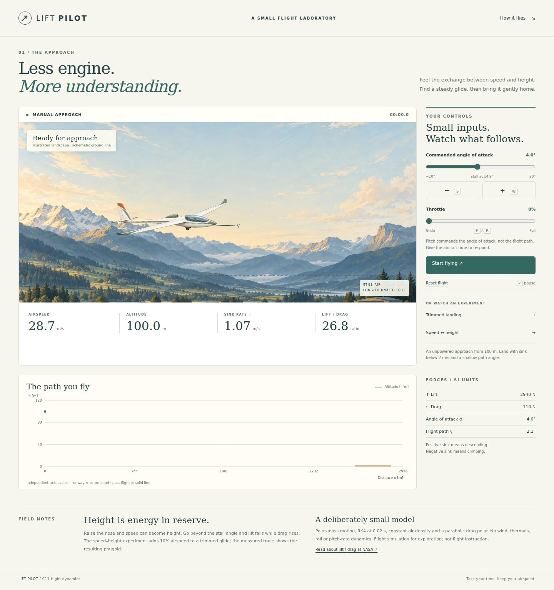
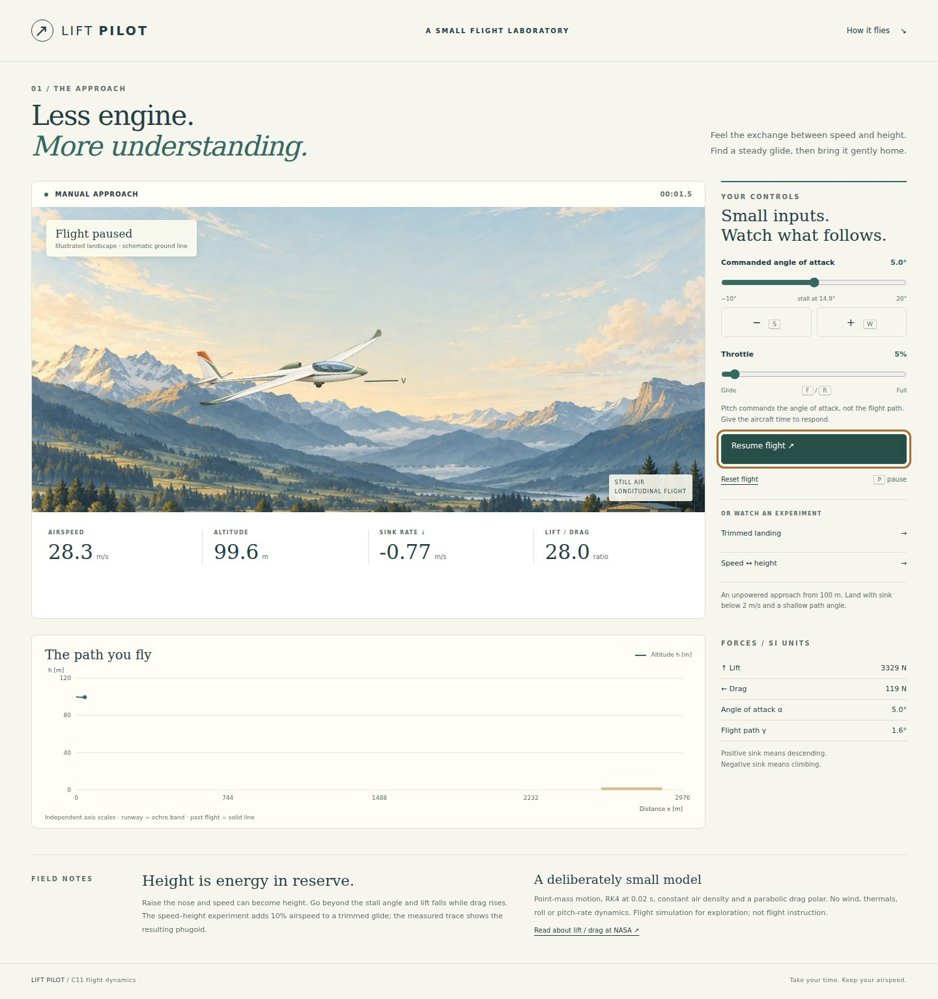
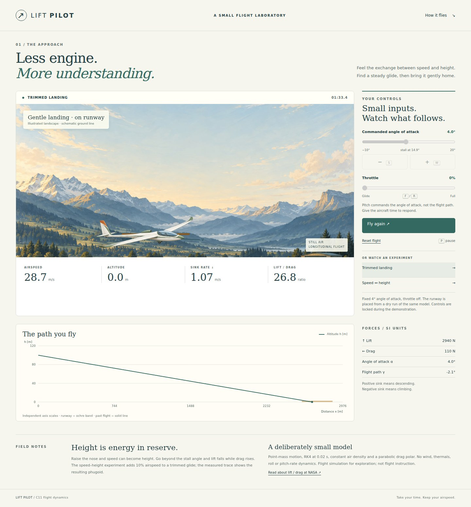
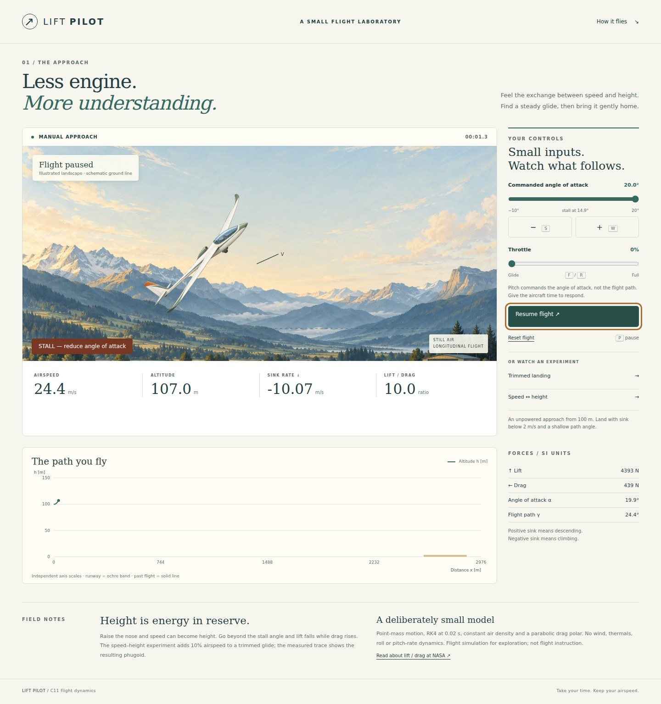
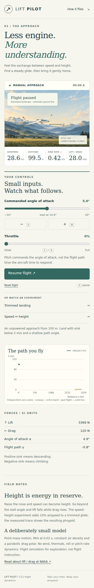
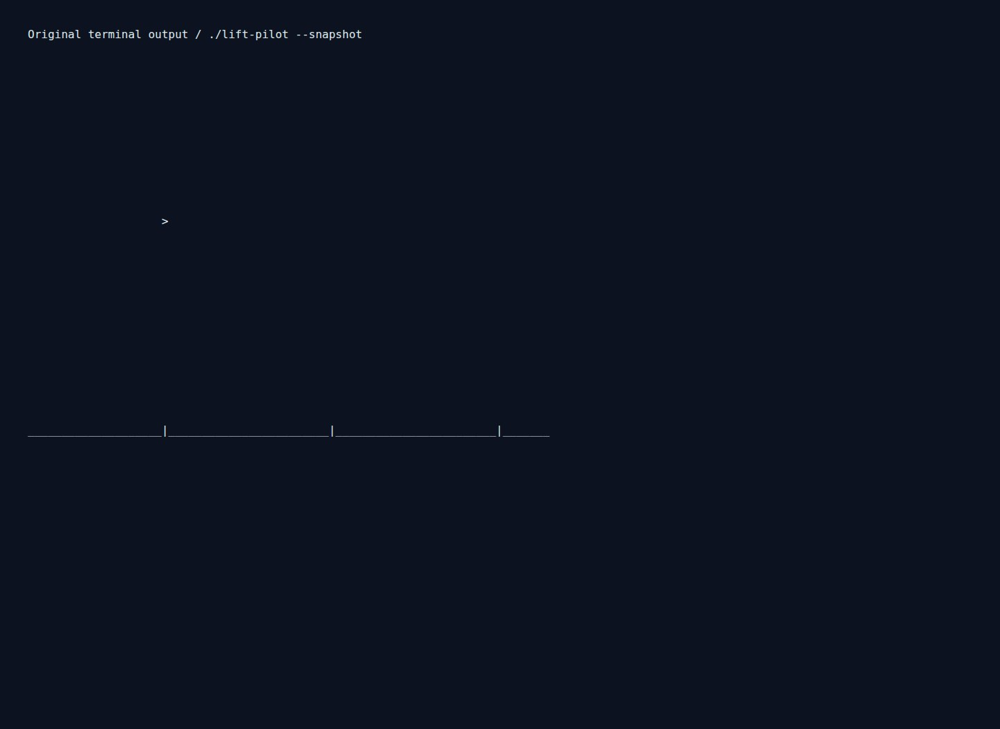
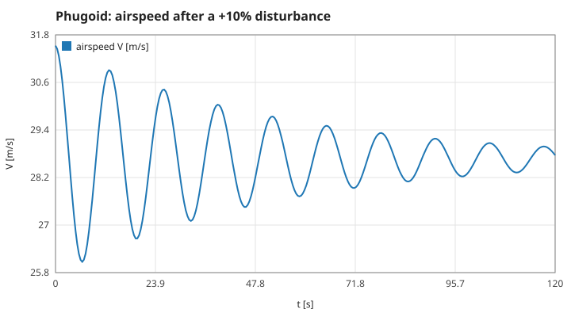
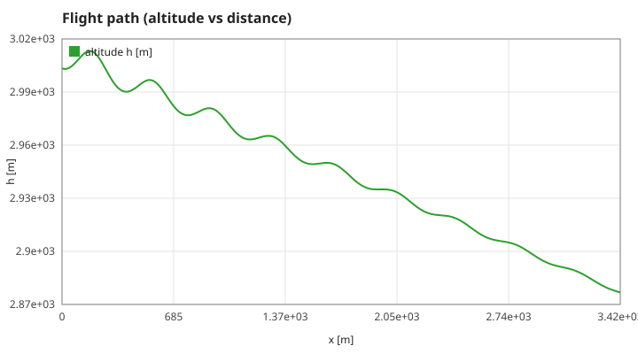
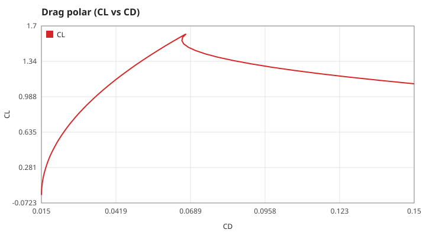
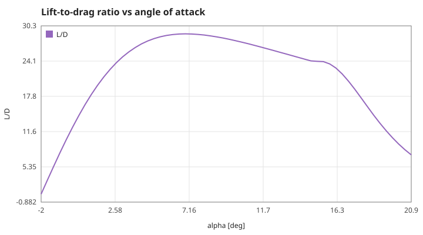

# lift-pilot

Fly a motor glider in a small flight laboratory. A C11 flight-dynamics simulator with
an illustrated browser cockpit and the original terminal view. Both use the same
point-mass longitudinal equations, RK4 integration and parabolic drag polar with stall.
(C言語の飛行力学シミュレータ。同じ物理モデルでブラウザーと端末から滑空機を操縦できます。)



## Browser

With a C compiler, Emscripten on PATH, Python 3.14 and Node.js installed:

```sh
make web
make play                      # http://localhost:4215
```

Start flying with **W/S** to change the commanded angle of attack and **R/F** for throttle.
**P** pauses. Sliders and the −/+ buttons also work with touch. The flight begins paused;
switching away from the page pauses it. Reset returns to a manual approach from 100 m.
There is no persistence or external API. The browser downloads only local files.

- **Trimmed landing**: a fixed 4° unpowered glide. The runway is placed from a dry run,
  as in the original GIF demonstration; this is an observation, not a landing autopilot.
- **Speed ↔ height**: a 120 s observation from 3,000 m, starting 10% faster than trim.
  The measured airspeed trace shows the phugoid; manual controls are locked during demos.
- SI units, lift/drag, angle of attack, flight-path angle, stall and touchdown state come
  directly from C/WASM. Positive sink means descending. L/D is the current ratio.

The landscape and aircraft are original image-model artwork. The dashed ground line is
schematic; the separate plot has measured axes with independent horizontal/vertical scales.
This model has no wind, thermals, roll or pitch-rate dynamics and is not flight instruction.
See [art direction and prompts](docs/art-direction.md) and [validation](docs/validation.md).

## Actual screens







Before: actual original terminal snapshot; the terminal renderer remains available.



Original animated terminal demonstration:


## Run

```sh
make && ./lift-pilot            # interactive
./lift-pilot --snapshot         # one frame, no terminal needed
./lift-pilot --gif docs/demo.gif  # scripted landing as an animated GIF
make test && make plots         # unit tests and docs/*.svg
```

Keys: `w`/`s` pitch (commanded angle of attack), `r`/`f` throttle, `p` pause, `q` quit. Land gently (sink < 2 m/s, path angle < 0.15 rad) on the `===` runway.

## Model

State `(x, h, V, γ, α)`; `α` follows the elevator command through a first-order lag.

```
V'  = (T − D)/m − g sin γ
γ'  = (L/m − g cos γ) / V
x'  = V cos γ
h'  = V sin γ
```

`CL = CL0 + CLα·α` up to the stall angle, then falls; `CD = CD0 + k·CL²` plus a stall term. Best glide ratio is `1/(2√(CD0·k))` ≈ 28.9.

## Results

Phugoid: a trimmed glide hit with +10 % airspeed trades speed for height in a slowly damped oscillation.






## Tests

`tests/test_flight.c` checks: numeric best L/D vs the analytic value (1 %), lift peak at stall, steady glide stays steady, energy conservation without drag, phugoid period vs Lanchester's `π√2·V/g` (10 %), touchdown rating, renderer bounds.

```sh
make test                      # C model, GIF codec, browser adapter
make bench                     # native trajectories and landing checks
npm ci                         # local-only Playwright development dependency
make smoke                     # real WASM, keyboard/touch, errors, screenshots
```

The smoke compares native and WASM trajectories for manual flight, trimmed landing and
phugoid before exercising the UI. CI runs only the C tests on pull requests; browser
builds and captures stay local. Initial distribution, including art, is checked against
10,000,000 B by `make web`. Human first-play evaluation, actual mobile hardware and
real-GPU performance remain unverified. No public web deployment has been made.

## Roadmap

See the Issues: short-period pitch dynamics, thermals, 3D view.

Part of a series of small C physics toys, tracked in [algo-vis-panel](https://github.com/TM-59/algo-vis-panel/issues/6). MIT licensed.
