# lift-pilot

Fly a motor glider in a small flight laboratory. A C11 flight-dynamics simulator with
an illustrated browser cockpit and the original terminal view. Both use the same
point-mass longitudinal equations, RK4 integration and parabolic drag polar with stall.
(C言語の飛行力学シミュレータ。同じ物理モデルでブラウザーと端末から滑空機を操縦できます。)

**Theory handbook:** [docs/theory](docs/theory/README.md) states every law, numerical rule and game rule the code relies on (29 statements), each with a figure, the function that implements it and the test or measurement that checks it. `make theory-figs` regenerates the figures from the flight model; `make theory-check` verifies the coverage table.
(理論の手引き: コードが拠る法則・数値計算の規則・ゲームの規則を、図・実装箇所・検査とともに `docs/theory` にまとめています。)

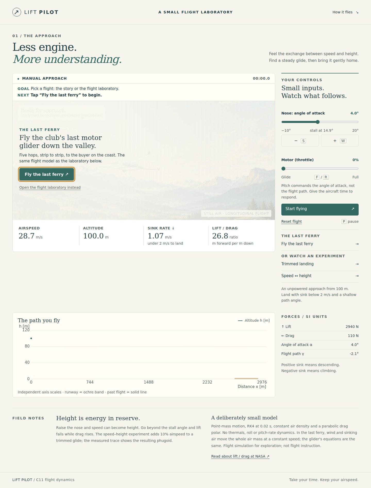

## The Last Ferry

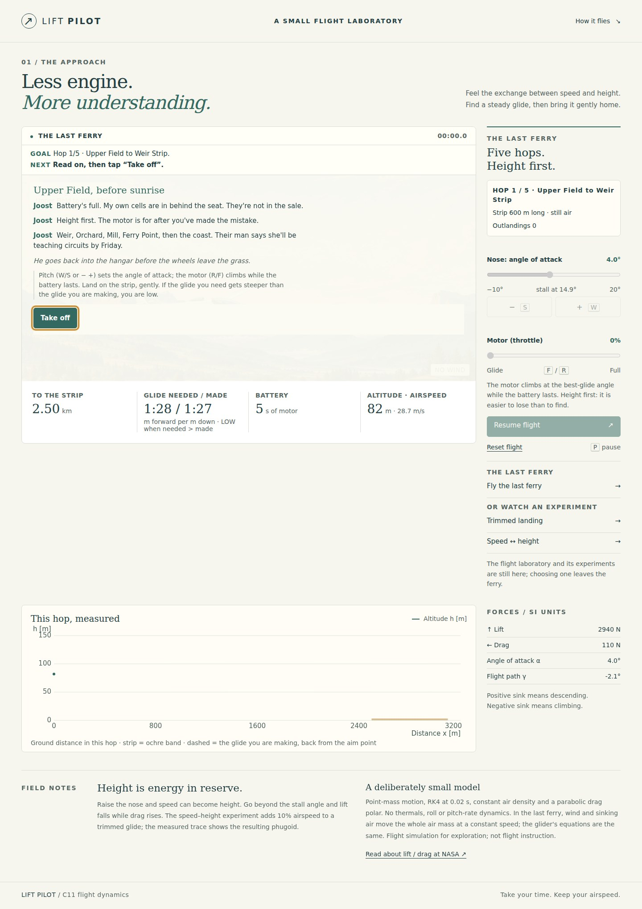

The club is closed and its last motor glider, the Kestrel, has been sold to a flight school on
the coast. Fly her down the valley in five hops, strip to strip, with Joost's spare cells in the
battery. Start it with **Fly the last ferry** on the welcome card or in the controls.

- Same flight model and controls as the laboratory. Each hop starts at the top of the climb-out
  and ends with a landing; land on the strip with sink below 2 m/s. Short, long or hard is an
  outlanding: the hop is flown again, and the third outlanding in a hop ends it on a trailer.
- Two needles tell you whether you will make it: the **glide needed** to reach the strip
  (distance over energy height) and the **glide made** over the ground. LOW lights while the first
  is steeper than the second. The motor climbs while the battery lasts.
- Story scenes open at the end of each hop and change only game numbers: the battery, where the
  strip is and how long, the air (a uniform headwind or sinking air carries the whole air mass),
  and, if you let Joost take the motor out at Mill Strip, the aircraft itself. Two choices, two endings.
- Above the view, `GOAL` says where to land and how far, and `NEXT` says what to do now and with which
  control (LOW: Motor 100%; stalling: nose down; low and sinking: flare). The control is outlined; on an
  upright phone a quick row (− Nose, + Nose, Motor 0%, Motor 100%) sits under the view.
- `make story` flies 524 runs with a human-like pilot and writes `docs/narrative/`;
  `make test` checks every story number and re-runs bench rows byte for byte.

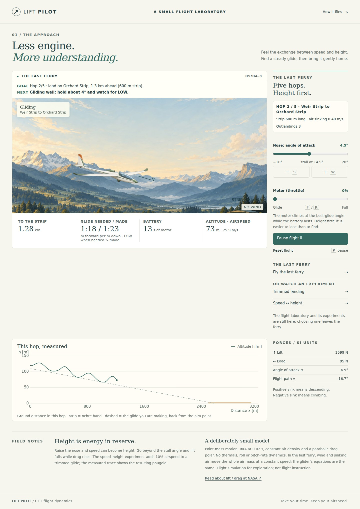
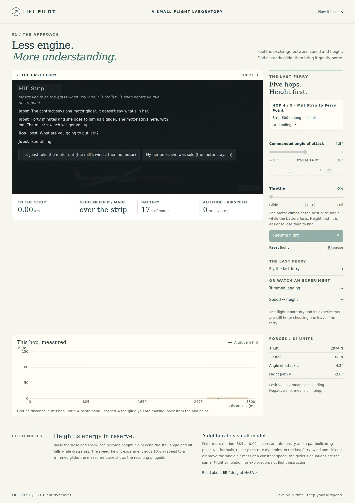
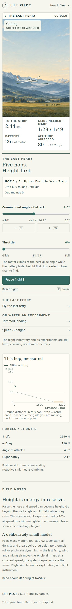
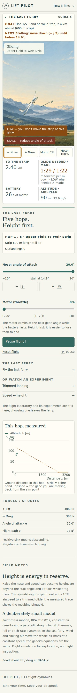

## Pitch laboratory: the short period

A second, rigid-body model (`src/pitch.c`) adds what the point-mass glider lacks: a pitch attitude
θ, a pitch rate q and a pitching moment from the static margin, pitch damping and the elevator.
The angle of attack is now `α = θ − γ`, set by the moment balance instead of a lag. The game, the
laboratory and The Last Ferry keep the lag model; their outputs are unchanged byte for byte.
Linearised about the 4° glide, the four eigenvalues split into two oscillations, checked against
their theory (`make test`, values from `make theory-figs`):

| Quantity (default: static margin 0.15) | Measured | Theory | Difference |
|---|---|---|---|
| Short-period frequency (eigenvalue vs `ω² = −Mα − Z·Mq`) | 4.1941 rad/s | 4.1773 rad/s | 0.40 % |
| Short-period damping ratio | 0.64850 | 0.64807 | 0.07 % |
| Damped frequency from the simulated pitch rate vs the eigenvalue | 3.19196 rad/s | 3.19259 rad/s | 0.02 % |
| Damping ratio from successive peaks vs the eigenvalue | 0.64876 | 0.64850 | 0.04 % |
| Phugoid period vs Lanchester × √(1 + Z·κ) | 16.908 s | 16.838 s | 0.42 % |
| Phugoid period without pitch damping vs Lanchester `π√2·V/g` | 13.089 s | 12.989 s | 0.77 % |
| Steady α 3000 s after a 1° nose-up elevator step vs the moment balance | 5.45460° | 5.45455° | 0.001 % |
| Growth rate at static margin −0.05 vs the positive eigenvalue | 0.33475 /s | 0.33466 /s | 0.03 % |
| Largest stable RK4 step (simulation) vs where RK4 growth R(λ·dt) reaches 1 in size | 0.63339 s | 0.63339 s | 5e-8 |

In the browser, the pitch laboratory below the flight view shows the glider at its true attitude,
α and q against time, and the eigenvalues in the complex plane; move the centre of gravity, step
the elevator or kick the nose. Behind the neutral point it diverges.

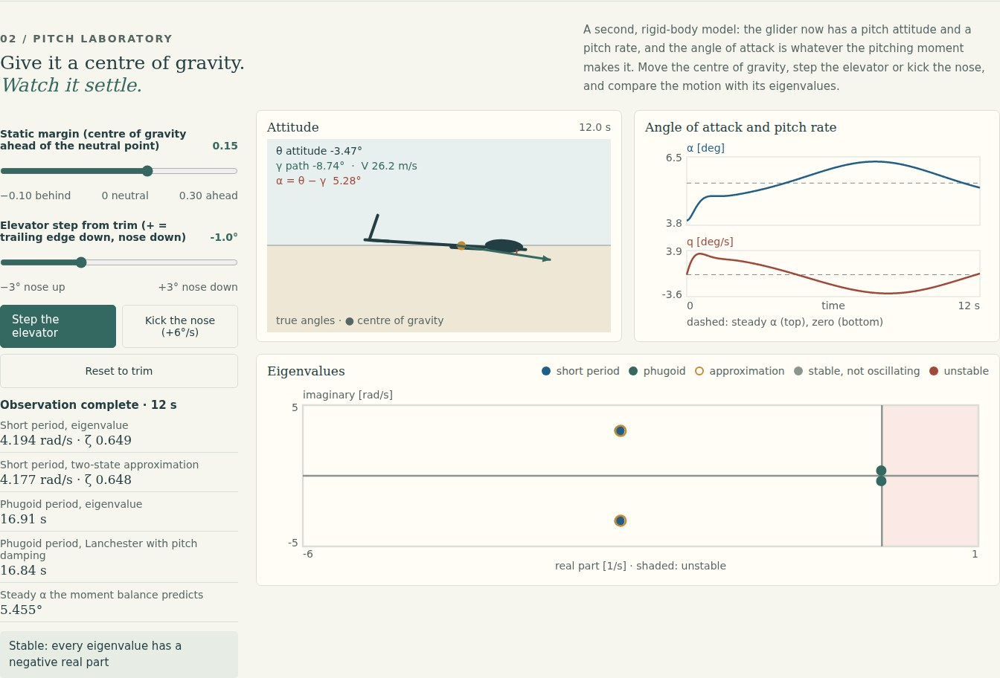
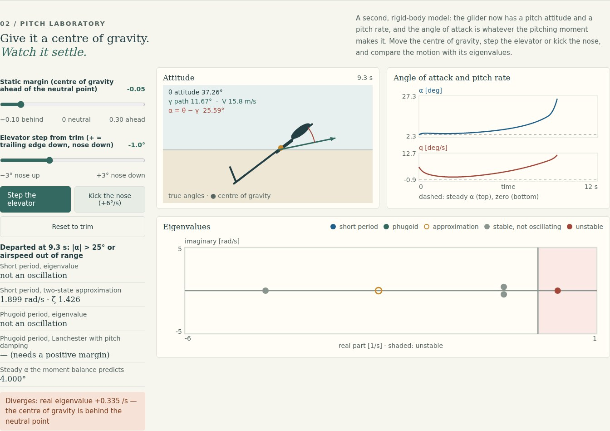
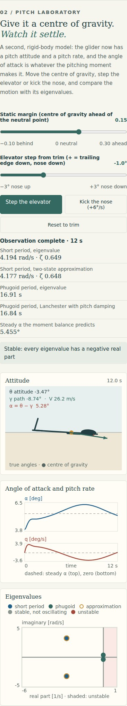

The terminal program draws the same step for two centre-of-gravity positions
(`./lift-pilot --pitch docs/pitch.svg`, part of `make plots`):

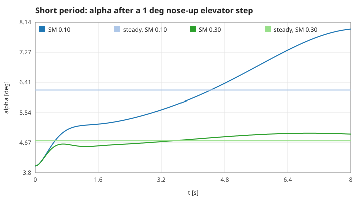

## Browser

With a C compiler, Emscripten on PATH, Python 3.14 and Node.js installed:

```sh
make web
make play                      # http://localhost:4215
```

Start flying with **W/S** to change the commanded angle of attack and **R/F** for throttle.
**P** pauses. Sliders and the −/+ buttons also work with touch. The flight begins paused;
switching away from the page pauses it. Reset returns to a manual approach from 100 m.
There is no persistence or external API. The browser downloads only local files.

- **Trimmed landing**: a fixed 4° unpowered glide. The runway is placed from a dry run,
  as in the original GIF demonstration; this is an observation, not a landing autopilot.
- **Speed ↔ height**: a 120 s observation from 3,000 m, starting 10% faster than trim.
  The measured airspeed trace shows the phugoid; manual controls are locked during demos.
- SI units, lift/drag, angle of attack, flight-path angle, stall and touchdown state come
  directly from C/WASM. Positive sink means descending. L/D is the current ratio.

The landscape and aircraft are original image-model artwork. The dashed ground line is
schematic; the separate plot has measured axes with independent horizontal/vertical scales.
This model has no thermals or roll, and pitch-rate dynamics only in the separate pitch laboratory (the
ferry's wind and sinking air move the whole air mass). It is not flight instruction.
See [art direction and prompts](docs/art-direction.md) and [validation](docs/validation.md).

## Actual screens

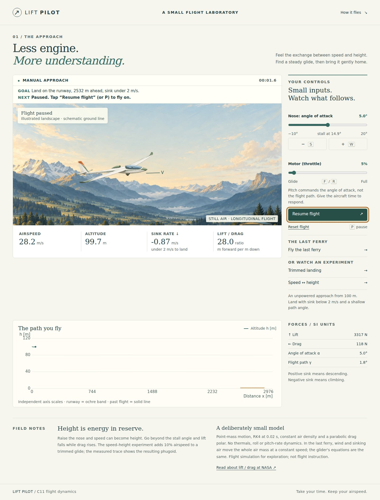
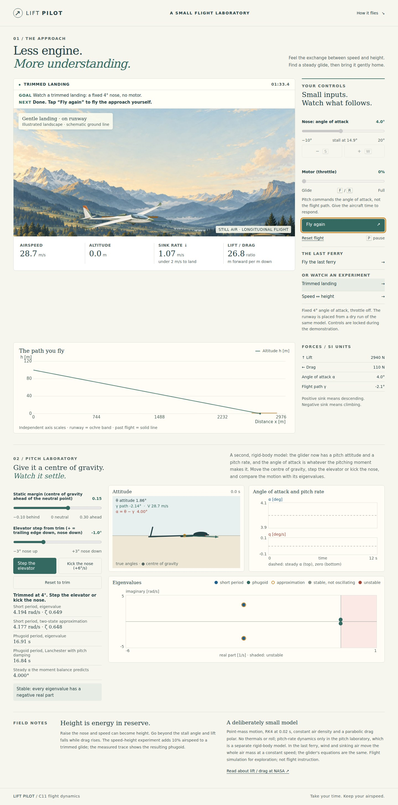
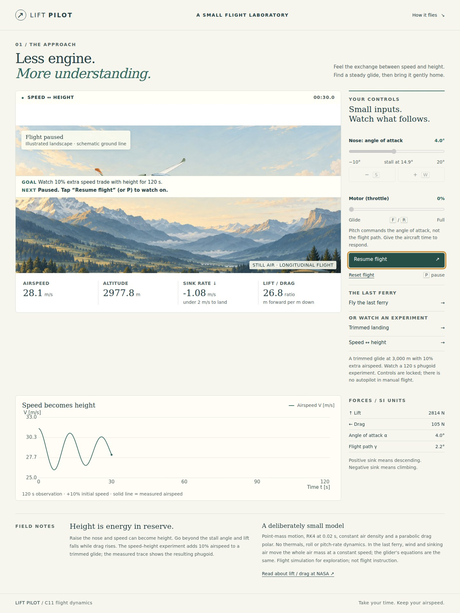
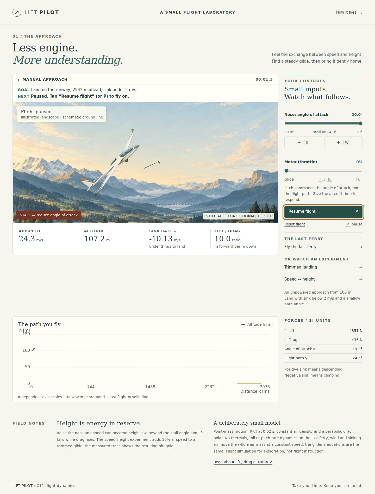
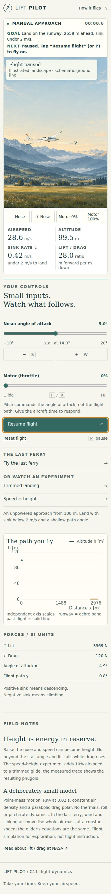

Before: actual original terminal snapshot; the terminal renderer remains available.

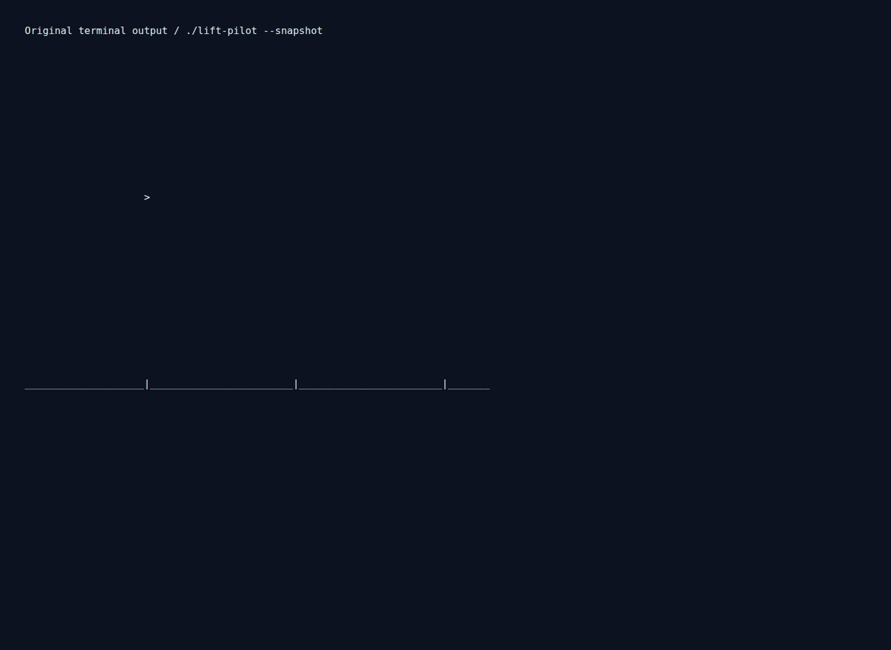

Original animated terminal demonstration:


## Run

```sh
make && ./lift-pilot            # interactive
./lift-pilot --snapshot         # one frame, no terminal needed
./lift-pilot --gif docs/demo.gif  # scripted landing as an animated GIF
./lift-pilot --pitch docs/pitch.svg  # rigid-body elevator step, two centre-of-gravity positions
make test && make plots         # unit tests and docs/*.svg
```

Keys: `w`/`s` pitch (commanded angle of attack), `r`/`f` throttle, `p` pause, `q` quit. Land gently (sink < 2 m/s, path angle < 0.15 rad) on the `===` runway.

## Model

State `(x, h, V, γ, α)`; `α` follows the elevator command through a first-order lag.

```
V'  = (T − D)/m − g sin γ
γ'  = (L/m − g cos γ) / V
x'  = V cos γ
h'  = V sin γ
```

`CL = CL0 + CLα·α` up to the stall angle, then falls; `CD = CD0 + k·CL²` plus a stall term. Best glide ratio is `1/(2√(CD0·k))` ≈ 28.9.

## Results

Phugoid: a trimmed glide hit with +10 % airspeed trades speed for height in a slowly damped oscillation.

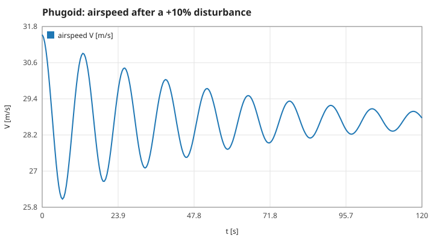
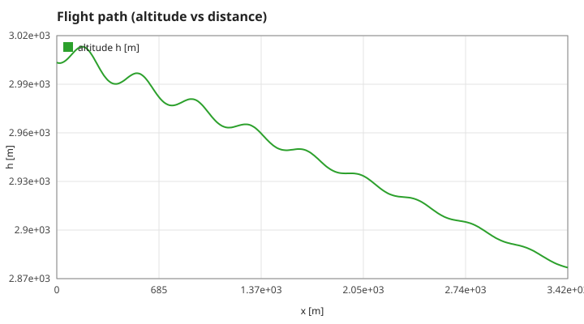
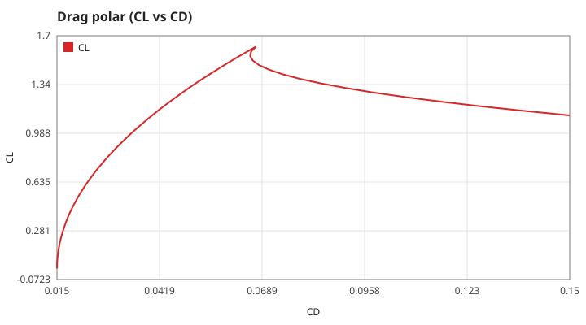
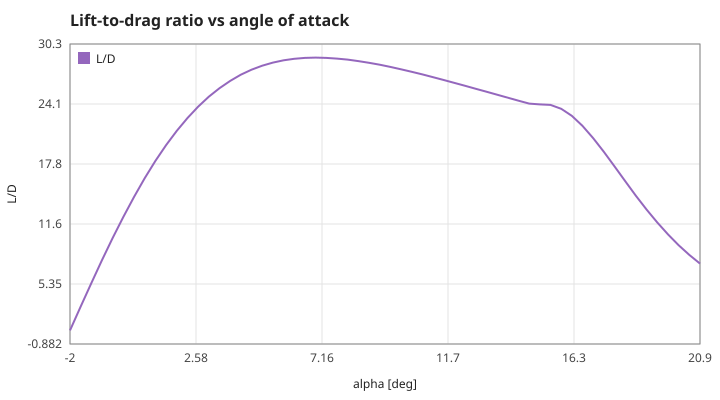

## Tests

`tests/test_flight.c` checks: numeric best L/D vs the analytic value (1 %), lift peak at stall, steady glide stays steady, energy conservation without drag, phugoid period vs Lanchester's `π√2·V/g` (10 %), touchdown rating, renderer bounds. `tests/test_pitch.c` checks the rigid-body model: the eigenvalue solver on a known matrix, trim as an exact equilibrium, energy without drag, the short-period approximation and the corrected phugoid (5 %), the simulated response against the eigenvalue, the elevator step, divergence behind the neutral point and the RK4 step limit.

```sh
make test                      # C model, GIF codec, browser adapter, the ferry (Debian 13, as CI)
make story                     # rewrite docs/narrative/ from the story bench
make bench                     # native trajectories and landing checks
npm ci                         # local-only Playwright development dependency
make smoke                     # real WASM, keyboard/touch, errors, screenshots
```

The smoke compares native and WASM trajectories for manual flight, trimmed landing and
phugoid before exercising the UI, compares the WebAssembly pitch eigenvalues with the native ones,
flies the ferry through both endings with real clicks, and drives the pitch laboratory at 1440, 1024, 390 and 844 px wide.
CI runs only the C tests (`docker build .`) on pull requests; browser
builds and captures stay local. Initial distribution, including art, is checked against
10,000,000 B by `make web`. Human first-play evaluation, actual mobile hardware and
real-GPU performance remain unverified. No public web deployment has been made.

## Roadmap

See the Issues: thermals, 3D view.

Part of a series of small C physics toys, tracked in [algo-vis-panel](https://github.com/TM-59/algo-vis-panel/issues/6). MIT licensed.
