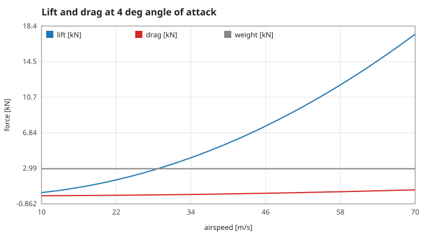
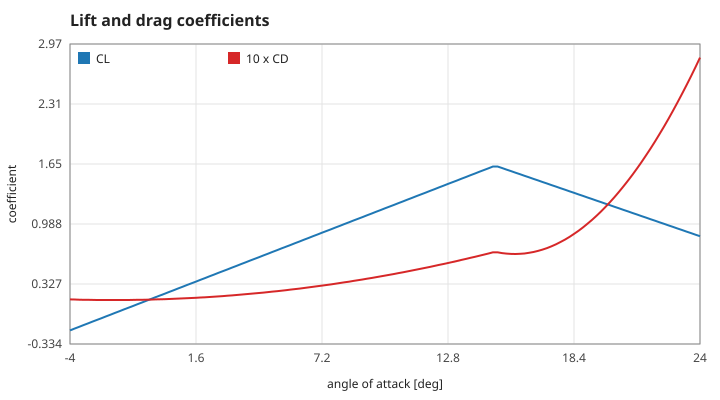
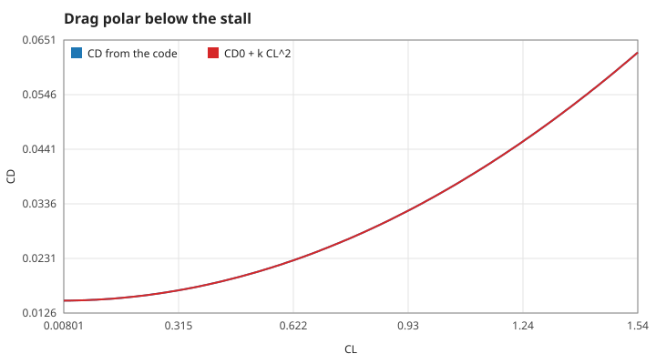
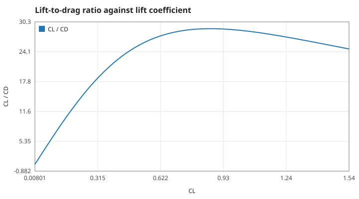

# 1. Aerodynamic forces

SI units throughout: metres, seconds, kilograms, newtons, radians (degrees only where a figure or a control says so). The default aircraft (`glider_default`): mass $m = 300$ kg, wing area $S = 10\ \mathrm{m^2}$, air density $\rho = 1.225\ \mathrm{kg/m^3}$, $C_{L0} = 0.2$, $C_{L\alpha} = 5.5$ per rad, stall angle $\alpha_s = 0.26$ rad, $C_{D0} = 0.015$, $k = 0.02$. Every number quoted is taken from [figures/values.md](figures/values.md), which `make theory-figs` regenerates.

## S01 — Lift and drag

**Statement.**

$$L = q\,S\,C_L(\alpha), \qquad D = q\,S\,C_D(\alpha), \qquad q = \tfrac12\rho V^2 .$$

Lift acts at right angles to the flight path, drag along it and backwards. Both grow with the square of the airspeed $V$.

*Figure: lift and drag at a fixed angle of attack of 4°, with the weight $mg$ for comparison. Lift equals weight at 28.7 m/s — the trim speed of S06.*

**Assumptions and where they break.** Constant air density (no altitude effect), coefficients that depend on the angle of attack only (no Mach or Reynolds number effect), a rigid aircraft. Reasonable for a glider below 100 m/s near sea level.

**Derivation.** Dimensional analysis: a force on a body of area $S$ in a stream of density $\rho$ and speed $V$ is $\tfrac12\rho V^2 S$ times a dimensionless coefficient.

**Code.** `lift_force`, `drag_force` in `src/flight.c` (with the static helper `dynamic_pressure`); `glider_default` holds the constants.

**Tests.** `test_steady_glide_stays_steady` in `tests/test_flight.c` (lift and drag balance the weight in a trimmed glide); measured value `lift-30` (3219.15 N at 30 m/s and 4°, equal to the formula).

## S02 — The lift curve and the stall

**Statement.**

$$C_L(\alpha) = \begin{cases} C_{L0} + C_{L\alpha}\,\alpha, & \alpha \le \alpha_s \\ \max\big(C_{L,s}\,[1 - 3(\alpha - \alpha_s)],\ 0.3\,C_{L,s}\big), & \alpha > \alpha_s \end{cases} \qquad C_{L,s} = C_{L0} + C_{L\alpha}\alpha_s = 1.63 .$$

Below the stall angle lift grows linearly; past it the lift falls, down to a floor of 30 % of its peak.

*Figure: $C_L$ (blue) and ten times $C_D$ (red) from −4° to 24°. The kink at 14.9° (0.26 rad) is the stall.*

**Assumptions and where they break.** A piecewise-linear model of a real lift curve: no hysteresis, no gradual rounding before the stall, and the post-stall slope and floor are chosen for playability, not measured.

**Derivation.** Thin-aerofoil theory gives a straight lift curve at small angles; the break and the floor are a model.

**Code.** `lift_coeff` in `src/flight.c`.

**Tests.** `test_lift_peaks_at_the_stall_angle`; measured values `cl-at-stall` (1.63) and `cl-floor` (0.489 at 0.60 rad).

## S03 — The drag polar

**Statement.**

$$C_D = C_{D0} + k\,C_L^2 \quad (\alpha \le \alpha_s), \qquad C_D = C_{D0} + k\,C_L^2 + 10\,(\alpha - \alpha_s)^2 \quad (\alpha > \alpha_s).$$

$C_{D0}$ is the drag at zero lift; $kC_L^2$ is the drag caused by making lift (induced drag).

*Figure: $C_D$ returned by the code (blue) lies on the parabola $C_{D0} + kC_L^2$ (red) for every angle below the stall.*

**Assumptions and where they break.** A parabolic polar is accurate for the middle of the speed range; near the stall real drag rises earlier. The quadratic penalty past the stall is a model.

**Derivation.** Lifting-line theory: induced drag coefficient $C_L^2/(\pi e A)$, so $k = 1/(\pi e A)$ for aspect ratio $A$ and efficiency $e$.

**Code.** `drag_coeff` in `src/flight.c`.

**Tests.** `test_lift_peaks_at_the_stall_angle` (drag rises past the stall); `test_best_glide_matches_the_polar`.

## S04 — Best glide ratio

**Statement.** The lift-to-drag ratio is largest where the two parts of the drag are equal, $C_L^\star = \sqrt{C_{D0}/k}$, and there

$$\left(\frac{L}{D}\right)_{\max} = \frac{1}{2\sqrt{C_{D0}\,k}} = 28.87 .$$

*Figure: $C_L/C_D$ over the sweep of angles; the peak is at $C_L = 0.866$.*

**Assumptions.** The parabolic polar of S03, below the stall.

**Derivation.** Minimise $C_D/C_L = C_{D0}/C_L + kC_L$: the derivative vanishes at $C_L^2 = C_{D0}/k$, giving $C_D/C_L = 2\sqrt{C_{D0}k}$.

**Code.** `best_glide_ratio` in `src/flight.c`.

**Tests.** `test_best_glide_matches_the_polar`; measured values `best-glide` (28.8673 against 28.8675) and `best-glide-cl` (0.862 against 0.866, limited by the 0.1° sweep).

Reference: J. D. Anderson, *Introduction to Flight*, 8th ed., McGraw-Hill (2016), ch. 5–6; F. Irving, *The Paths of Soaring Flight*, Imperial College Press (1999), ch. 2.
