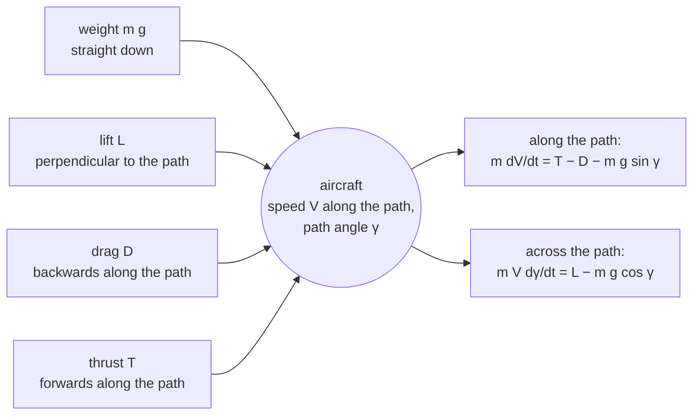
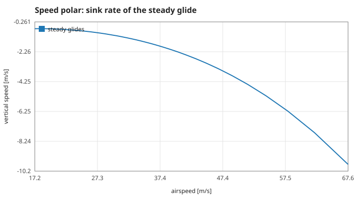
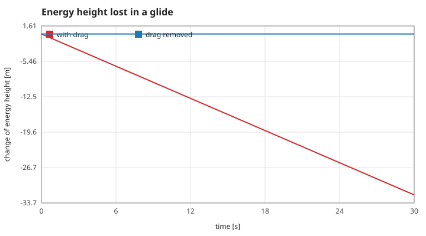
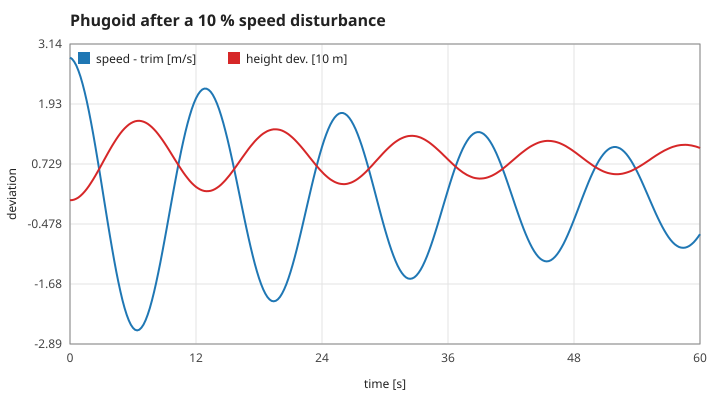
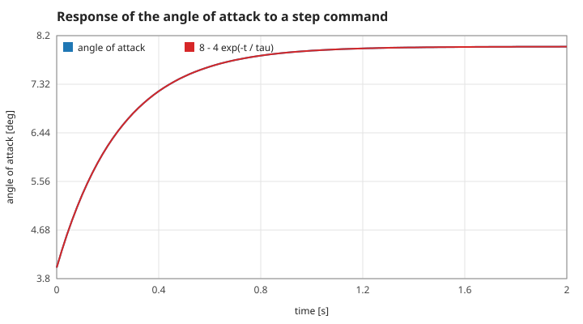

# 2. Equations of motion

## S05 — Point-mass motion in the vertical plane

**Statement.** With position $(x, h)$, airspeed $V$, flight-path angle $\gamma$ (positive when climbing) and thrust $T$ along the path,

$$\dot x = V\cos\gamma,\qquad \dot h = V\sin\gamma,\qquad \dot V = \frac{T - D}{m} - g\sin\gamma,\qquad \dot\gamma = \frac{1}{V}\Big(\frac{L}{m} - g\cos\gamma\Big).$$

$T = \text{throttle} \times T_{\max}$ with $T_{\max} = 0.1\,mg$ and $g = 9.80665\ \mathrm{m/s^2}$.

*Figure: the four forces and the two equations they give when resolved along and across the flight path.*

**Assumptions and where they break.** A point mass: no pitch inertia (the aircraft takes its angle of attack through the lag of S09, not through a pitching moment), flat Earth, still air, thrust aligned with the path. The equation for $\gamma$ divides by $V$, so it fails at zero airspeed; the model is not used on the ground.

**Derivation.** Newton's second law in path axes: the tangential component gives $\dot V$, the normal component gives the centripetal term $mV\dot\gamma$.

**Code.** The static function `derivative` in `src/flight.c`, called by `flight_step`.

**Tests.** `test_steady_glide_stays_steady`, `test_energy_is_conserved_without_drag`.

## S06 — The steady glide and the speed polar

**Statement.** With no thrust, a steady glide ($\dot V = \dot\gamma = 0$) at angle of attack $\alpha$ has

$$\tan\gamma = -\frac{C_D}{C_L}, \qquad V = \sqrt{\frac{2\,m\,g\cos\gamma}{\rho\,S\,C_L}} .$$

The glide ratio over the ground in still air equals $C_L/C_D$.

*Figure: vertical speed against airspeed for the steady glide at every angle of attack from the stall (left) to −1° (right). The top of the curve is the minimum sink, 0.71 m/s at 17.9 m/s; the tangent from the origin touches it at the best-glide speed.*

**Assumptions.** Still air; the angle of attack held constant.

**Derivation.** Set $\dot V = 0$ and $\dot\gamma = 0$ in S05: $D = -mg\sin\gamma$ and $L = mg\cos\gamma$. Divide for the angle; substitute $L = \tfrac12\rho V^2 S C_L$ for the speed.

**Code.** `trim_glide` in `src/flight.c`.

**Tests.** `test_steady_glide_stays_steady`; measured values `trim-speed-4deg` (28.6695 m/s), `trim-angle-4deg` (−0.0373 rad), `steady-speed` (unchanged after 30 s).

## S07 — Energy

**Statement.** The specific energy $e = \tfrac12V^2 + gh$ changes only through thrust and drag:

$$\dot e = \frac{(T - D)\,V}{m}.$$

Without drag and thrust it is conserved; lift does no work because it is perpendicular to the path.

*Figure: change of the energy height $e/g$ over 30 s. With drag (red) it falls at the steady rate $DV/mg$; with the drag coefficients set to zero (blue) it stays put.*

**Assumptions.** Still air (in moving air the energy relative to the ground also changes; see S14).

**Derivation.** $\dot e = V\dot V + g\dot h$; insert S05: $V(T - D)/m - gV\sin\gamma + gV\sin\gamma$.

**Code.** `specific_energy` in `src/flight.c`.

**Tests.** `test_energy_is_conserved_without_drag`; measured values `energy-no-drag` ($2\times10^{-13}$ relative change in 30 s) and `energy-rate` (−10.4981 W/kg, equal to $-DV/m$).

## S08 — The phugoid

**Statement.** A glider disturbed from its trim speed $V_e$ at constant angle of attack trades speed for height and back with period

$$T_\text{phugoid} = \pi\sqrt2\,\frac{V_e}{g}$$

(Lanchester's formula). At $V_e = 28.67$ m/s this is 12.99 s.

*Figure: speed about the trim value (blue) and height about the steady descent (red, in units of 10 m) after a 10 % speed disturbance. They are a quarter of a cycle apart, and drag damps both.*

**Assumptions and where they break.** Constant angle of attack, small disturbances, and no drag in the derivation: the real period is slightly different and the motion decays. Measured 12.96 s against 12.99 s (`phugoid-period`).

**Derivation.** With constant $C_L$, lift $\propto V^2$. Energy conservation gives $V^2 = V_e^2 - 2g\,z$ for a height deviation $z$; the net vertical force is $L - mg = mg(V^2/V_e^2 - 1) = -2mg^2 z/V_e^2$: a harmonic oscillator with $\omega^2 = 2g^2/V_e^2$.

**Code.** A consequence of `flight_step`; the browser's mode 2 (`lp_reset` in `src/observer.c`) starts exactly this experiment.

**Tests.** `test_phugoid_period_follows_lanchester`.

## S09 — The angle of attack follows the stick through a lag

**Statement.** The pilot commands an angle of attack $\alpha_c$; the aircraft follows with a first-order lag of time constant $\tau = 0.25$ s:

$$\dot\alpha = \frac{\alpha_c - \alpha}{\tau}, \qquad \alpha(t) = \alpha_c - (\alpha_c - \alpha_0)\,e^{-t/\tau}\ \text{ for a step}.$$

*Figure: the angle of attack after the command jumps from 4° to 8° (blue) on the exponential (red).*

**Assumptions and where they break.** This replaces the short-period pitch dynamics (pitch rate, elevator moment, damping) by a single lag: there is no overshoot and no pitch oscillation. Modelling those is a planned extension.

**Derivation.** A first-order model fitted to the fast, well-damped pitch response of a stable aircraft.

**Code.** `derivative` in `src/flight.c` (the `d->alpha` line), integrated by `flight_step`.

**Tests.** Measured value `lag-at-0.24s` (6.46843° against the formula to $1\times10^{-7}$); no assertion in `make test`.

Reference: F. W. Lanchester, *Aerodonetics*, Constable (1908); B. Etkin and L. D. Reid, *Dynamics of Flight*, 3rd ed., Wiley (1996), ch. 6.
