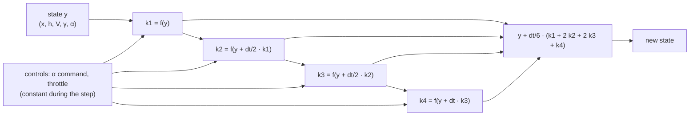
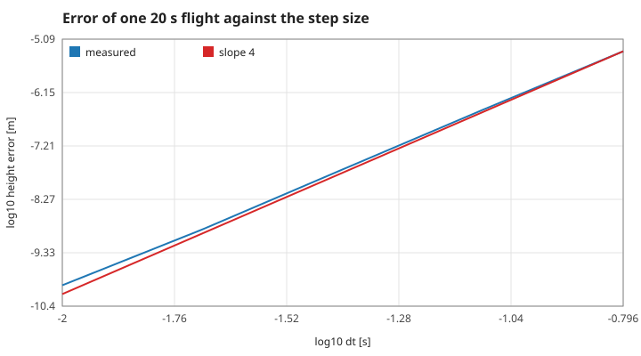
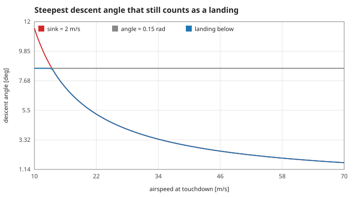
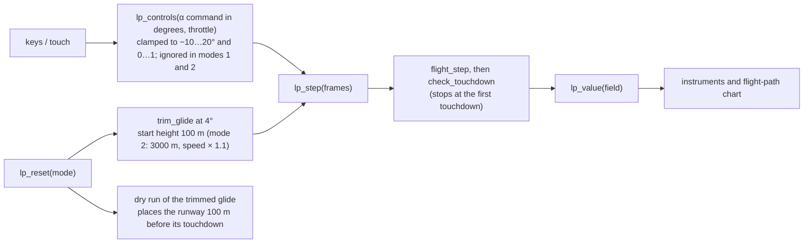

# 3. The numerical scheme, the ground and the screen

## S10 — The Runge–Kutta step

**Statement.** The state $y = (x, h, V, \gamma, \alpha)$ is advanced with the classical fourth-order Runge–Kutta step of size $dt = 0.02$ s, the controls held constant over the step:

$$k_1 = f(y),\quad k_2 = f\big(y + \tfrac{dt}{2}k_1\big),\quad k_3 = f\big(y + \tfrac{dt}{2}k_2\big),\quad k_4 = f(y + dt\,k_3),\qquad y \leftarrow y + \tfrac{dt}{6}(k_1 + 2k_2 + 2k_3 + k_4),$$

where $f$ is the right-hand side of S05 and S09.

*Figure: one step evaluates the equations of motion four times and blends the four slopes.*

**Assumptions.** A fixed step; one step per animation frame in the browser and per frame of the story layer.

**Derivation.** The weights make the Taylor expansion of the step agree with that of the exact solution through $dt^4$.

**Code.** `flight_step` in `src/flight.c`, with the static helpers `derivative` and `advance`.

**Tests.** `test_steady_glide_stays_steady`, `test_energy_is_conserved_without_drag`; `tests/test_observer.c` checks that the browser adapter takes exactly these steps (`lp_value(LP_X)` equals a direct integration to $1\times10^{-9}$ m).

## S11 — Fourth-order accuracy

**Statement.** The error of a flight of fixed duration is proportional to $dt^4$: halving the step divides it by 16.

*Figure: height error after a 20 s phugoid flight against a reference run with $dt = 0.00125$ s, in logarithmic axes. The measured points (blue) follow a line of slope 4 (red).*

**Assumptions and where they break.** The step must resolve the fastest process, the 0.25 s angle-of-attack lag; for steps approaching that the fourth-order behaviour is lost. At the game's step the error is $1.4\times10^{-9}$ m (`rk4-error-game`).

**Derivation.** Local error $O(dt^5)$ per step times $O(1/dt)$ steps.

**Code.** `flight_step` in `src/flight.c`.

**Tests.** Measured value `rk4-order` (ratio 15.26 between $dt = 0.08$ and $0.04$ s, against 16); no assertion in `make test`.

## S12 — Touchdown: landing or crash

**Statement.** While $h > 0$ the aircraft is flying. At the first step with $h \le 0$ the height is set to 0 and the touchdown is

- a **landing** if the sink rate $-V\sin\gamma$ is below 2 m/s **and** $|\gamma| < 0.15$ rad (8.6°);
- a **crash** otherwise.

*Figure: the steepest descent angle that still counts as a landing, against the airspeed at touchdown. Below 13.4 m/s the angle limit (grey) decides; above it the sink limit (red) does. Landings lie under the blue curve.*

**Assumptions and where they break.** The ground is flat at $h = 0$; there is no undercarriage model, no ground roll, no bounce and no check of the pitch attitude. Where the touchdown point lies (on a runway or not) is judged by the caller.

**Derivation.** A rule of the game; the two limits meet where $V\sin 0.15 = 2$, i.e. $V = 13.4$ m/s.

**Code.** `check_touchdown` in `src/flight.c`.

**Tests.** `test_touchdown_rating`; measured values `touchdown-soft`, `touchdown-steep`, `touchdown-fast`.

## S13 — From the model to the screen

**Statement.** The browser cockpit shows numbers computed by the C model. It has three modes: 0 manual approach, 1 a hands-off trimmed landing, 2 the phugoid experiment of S08. Each frame takes whole 0.02 s steps and then reads the state and the derived values (lift, drag, $C_L/C_D$, sink rate, energy, stall flag, runway position).

*Figure: the data path of the cockpit. The same C file runs natively in the tests and as WebAssembly in the page.*

**Assumptions.** The runway is 300 m long and placed from a dry run of the trimmed glide; it does not affect the physics, only the "on runway" flag.

**Derivation.** Not a physical law: a statement of what is displayed.

**Code.** `lp_reset`, `lp_controls`, `lp_step`, `lp_value` in `src/observer.c`; the terminal view uses `render_frame` in `src/render.c`.

**Tests.** `tests/test_observer.c` (`lp_reset(1)` lands on the runway with a sink below 2 m/s; `lp_reset(2)` starts the phugoid); `test_render_fits_the_screen` in `tests/test_flight.c`.

Reference: E. Hairer, S. P. Nørsett and G. Wanner, *Solving Ordinary Differential Equations I*, 2nd ed., Springer (1993), §II.1.
