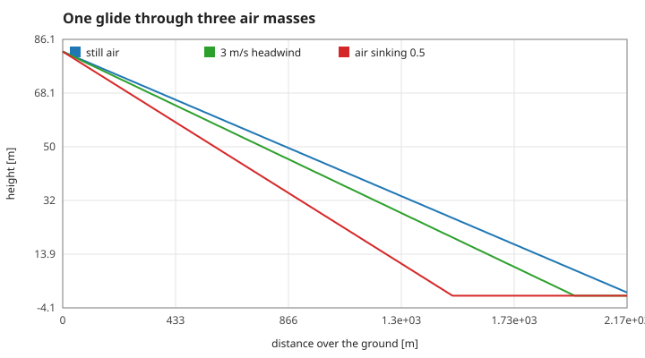
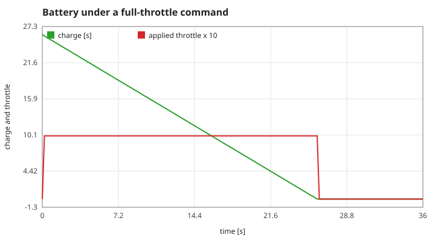
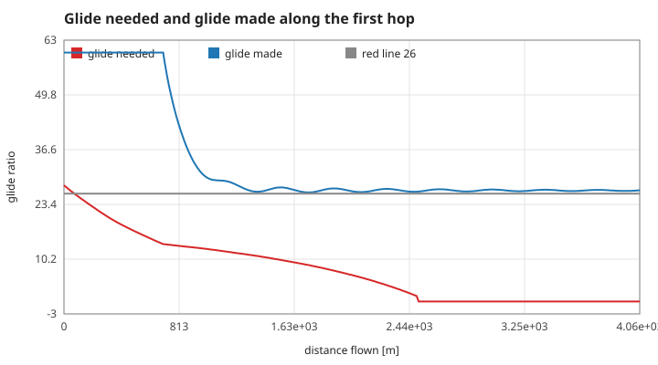
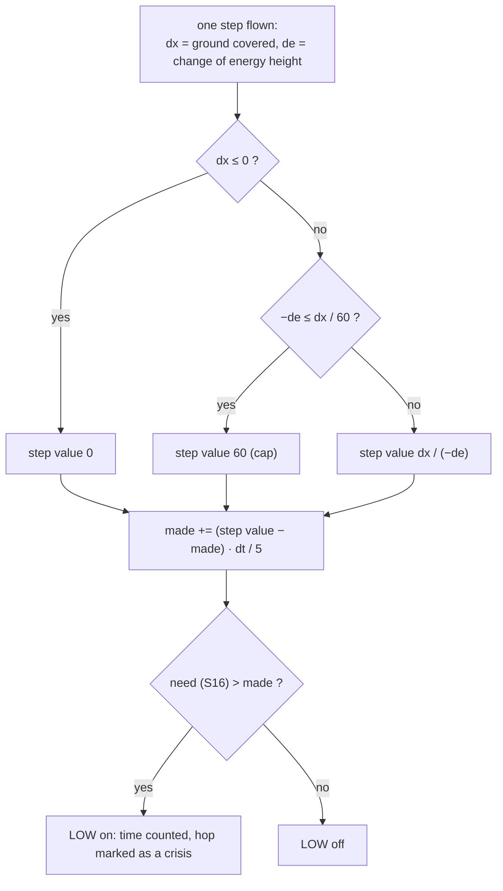
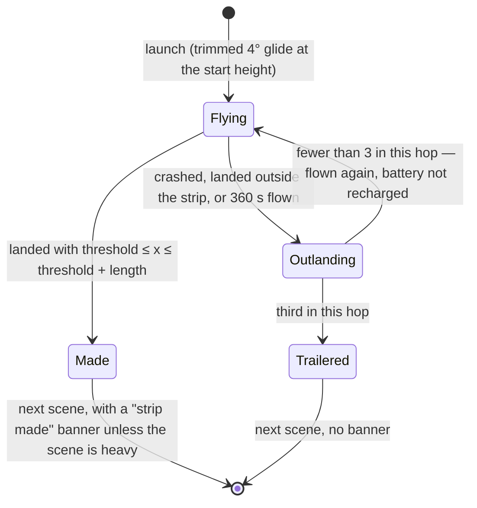
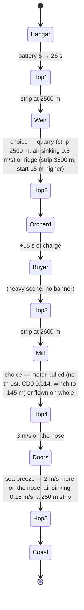

# 4. The Last Ferry: the rules of the game layer

`src/ferry.c` adds a game on top of the unchanged flight model: five hops down a valley, each from the top of a climb-out to a landing on a strip. One frame is one 0.02 s step of S10. All constants below are the `#define`s at the top of `src/ferry.c`.

## S14 — Moving air

**Statement.** Each hop is flown through an air mass that moves uniformly: a horizontal wind $w$ (negative on the nose) and a vertical motion $u$ (negative when sinking). The flight model runs unchanged in the air; after each step the position is carried with the air:

$$x \leftarrow x + w\,dt, \qquad h \leftarrow h + u\,dt .$$

A steady glide with air-relative speed components $(V_x, -s)$ therefore covers, over the ground, $\dfrac{V_x + w}{s - u}$ metres per metre of height lost.

*Figure: the 4° glide from 82 m. In still air it reaches 2172 m (blue, traced from the game layer); with 3 m/s on the nose 1944 m (green); in air sinking 0.5 m/s 1478 m (red). The green and red lines are drawn from the steady-glide formula; their end points are measured.*

**Assumptions and where they break.** The air moves as a block: no gusts, no wind gradient near the ground, no thermals with edges. Airspeed, lift and drag are unaffected by a uniform motion, which is exact.

**Derivation.** A Galilean change of frame: in the frame of the air the aircraft obeys S05; the ground moves backwards at $w$ and downwards at $u$.

**Code.** `ferry_tick` in `src/ferry.c` (the two lines after `flight_step`); the air of each hop is set in the static `start_hop`.

**Tests.** `tests/test_ferry.c`: "[flight] still air" (with no story numbers the layer is identical to `flight_step` for 1,500 frames), "[mech] weir", "[mech] buyer", "[mech] doors"; measured values `air-still`, `air-headwind`, `air-sink` (within 0.2 % of the formula).

## S15 — The battery

**Statement.** Charge is counted in seconds of full throttle. Each frame the applied throttle is the commanded one, limited to what the remaining charge can deliver, and the charge falls by throttle × $dt$. With no motor (after it is pulled) the applied throttle is 0.

*Figure: a full-throttle command from 26 s of charge. The charge (green) falls one second per second; when it reaches zero the applied throttle (red, ×10) drops to zero although the command is still full.*

**Assumptions.** Thrust is proportional to throttle (S05) and independent of speed; the battery has no voltage sag and does not recover.

**Derivation.** Bookkeeping.

**Code.** `ferry_tick` in `src/ferry.c` (the `power` and `f->charge` lines).

**Tests.** `tests/test_ferry.c`: "[mech] hangar" (5 → 26 s), "[mech] orchard" (+15 s); measured values `battery-start`, `battery-10s`, `battery-empty`.

## S16 — Energy height and the glide needed

**Statement.** The gauge reads height as a total-energy instrument does: speed above the reference 25 m/s counts as height,

$$h_e = h + \frac{V^2 - 25^2}{2g},$$

and the **glide needed** to reach a point 80 m past the strip threshold is

$$\text{need} = \frac{x_\text{strip} + 80 - x}{\max(h_e,\ 0.1)} \qquad (0 \text{ once over or past the threshold}).$$

*Figure: the first hop flown with the motor for 700 m and then as a glide. Red: glide needed. Blue: glide made (S17). Grey: the red line at 26 used by the benchmark.*

**Assumptions and where they break.** Using $h_e$ means that pulling up to trade speed for height does not move the needle. It ignores the energy still to be lost to drag while slowing down, and the wind.

**Derivation.** $V^2/2g$ is the height a speed can be converted into (S07).

**Code.** `ferry_need` and the static `energy_height` in `src/ferry.c`; `F_LOW_LINE` in `src/ferry.h`.

**Tests.** Measured value `need-start` (28.03 at the start of the first hop, equal to the formula); no assertion in `make test`.

## S17 — The glide made, and the LOW gauge

**Statement.** The **glide made** over the ground in one step is ground distance covered over energy height lost, capped at 60 (a climb or no loss reads 60), and the readout is that value smoothed with a 5 s lag:

$$\text{made} \leftarrow \text{made} + \big(\text{step value} - \text{made}\big)\frac{dt}{5} .$$

**LOW** is on whenever the glide needed exceeds the glide made.

*Figure: the calculation behind the two needles, once per frame.*

**Assumptions and where they break.** The readout lags by design, like a mechanical needle. **Known defect:** at the start of every hop the readout is initialised at the cap, 60, instead of the steady glide (26.8 for the 4° launch glide), because the launch code passes the sink rate with the wrong sign (issue #15). It then relaxes to the true value over about 15 s (visible at the left of the figure of S16), and during that time LOW cannot come on.

**Derivation.** Ground distance per unit of energy height lost is the glide ratio that matters for reaching a strip; the cap keeps a climb from producing a negative or infinite reading.

**Code.** `ferry_low_on`, `ferry_tick` and the static `glide_step` in `src/ferry.c`.

**Tests.** `tests/test_ferry.c`: "[mech] all story numbers off" and the per-beat checks use the time with LOW on as one of their two outcomes; measured values `making-start` (60, the defect), `low-start`.

## S18 — Making the strip, outlandings and the trailer

**Statement.** A hop is made when the touchdown is a landing (S12) between the strip threshold and its end (600 m; 250 m for the last strip). A crash, a landing short or long, or 360 s without landing is an outlanding: the aircraft is brought back and the hop is flown again from the same height, with the battery as it is. After the third outlanding in one hop a trailer finishes it by road.

*Figure: the life of one hop.*

**Assumptions.** The clock keeps running through re-flown hops: every second of the mission time is flown.

**Derivation.** Game rules.

**Code.** `ferry_tick` and the static `outland`, `clear_hop`, `launch` in `src/ferry.c`.

**Tests.** `tests/test_ferry.c`: "[mech] outlanding".

## S19 — Scenes: fixed order, and the numbers each one changes

**Statement.** Scenes open only at fixed progress points (before the first hop and after each hop). While one is open the clock stands still. A scene changes numbers of the game and nothing else; each change is one bit of `effects`, so the benchmark can remove them one at a time.

| Scene | Effect bit | What changes |
|---|---|---|
| Hangar | `FE_CELLS` | battery 5 → 26 s of full throttle |
| Weir | `FE_ROUTE` | quarry: strip at 2500 m, air sinking 0.5 m/s. Ridge: strip at 3500 m, start height +15 m |
| Orchard | `FE_ORCHARD` | +15 s of charge |
| Buyer | `FE_WIND` | hops 4 and 5: wind 3 m/s on the nose |
| Mill | `FE_MOTOR` | motor pulled: no thrust, charge 0, $C_{D0}$ 0.015 → 0.014, hops 4 and 5 start from a 145 m winch launch |
| Doors | `FE_DOORS` | hop 5: 2 m/s more on the nose, air sinking 0.15 m/s, strip 250 m long |

Start heights of the five hops: 82, 120, 98, 80, 88 m; strip thresholds: 2500, 3000, 2600, 3000, 2800 m (hop 2 is replaced by the Weir choice).

*Figure and table: the order of the run and the constants behind each scene.*

**Assumptions.** With an effect bit cleared the scene still opens but changes nothing (used by the benchmark).

**Derivation.** Game rules.

**Code.** `ferry_init`, `ferry_answer`, `ferry_options`, `ferry_heavy`, `ferry_ending`, `ferry_value` in `src/ferry.c`; the bits are the `FE_*` enum of `src/ferry.h`.

**Tests.** `tests/test_ferry.c`: "[order]", "[mech] hangar", "[mech] weir", "[mech] orchard", "[mech] buyer", "[mech] mill", "[mech] doors", "[quiet] buyer", "[quiet] mill", "[quiet] doors", "[choice]".
