# 5. Pitch dynamics: the rigid body

Pages 1–4 treat the glider as a point mass whose angle of attack follows the pilot's command through a lag (S09). This page adds the missing rotational degree of freedom in a separate model, `src/pitch.c`: the aircraft has a pitch attitude $\theta$ and a pitch rate $q$, and the angle of attack is whatever the moment balance makes it. The game, the laboratory and The Last Ferry still fly the lag model; their outputs are byte for byte the same as before this page existed. The new model is checked against its own linear theory and shown in the browser's pitch laboratory and in `docs/pitch.svg`.

Default aircraft (the point-mass glider of page 1 plus): chord $c = 1$ m, pitch inertia $I_{yy} = 400\ \mathrm{kg\,m^2}$, static margin $0.15$, $C_{m0} = 0.05$, pitch damping $C_{mq} = -10$, elevator power $C_{m\delta_e} = -1.2$ per rad. Every linearisation is about the steady 4° glide of S06 (28.67 m/s).

## S20 — Pitching moment and static stability

**Statement.** The pitching moment about the centre of gravity is $M = \bar q\,S\,c\,C_m$ with

$$C_m = C_{m0} + C_{m\alpha}\,\alpha + C_{mq}\,\frac{q\,c}{2V} + C_{m\delta_e}\,\delta_e,\qquad C_{m\alpha} = -C_{L\alpha}\,\text{SM},$$

where the static margin $\text{SM} = (x_\text{np} - x_\text{cg})/c$ is the distance of the centre of gravity ahead of the neutral point in chords. With $q = 0$ the moment vanishes at the trim angle

$$\alpha_\text{trim}(\delta_e) = -\frac{C_{m0} + C_{m\delta_e}\,\delta_e}{C_{m\alpha}},$$

and the elevator that trims a chosen angle is $\delta_e = -(C_{m0} + C_{m\alpha}\alpha)/C_{m\delta_e}$. A positive margin makes $C_m$ fall as $\alpha$ rises (a nose-up disturbance makes a nose-down moment): the aircraft is statically stable.

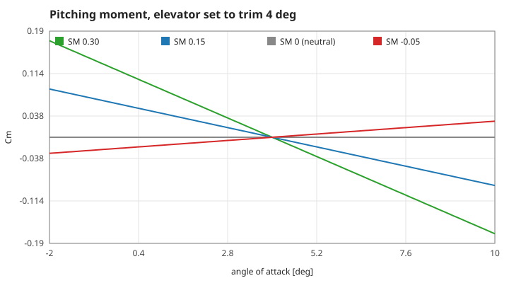

*Figure: $C_m$ against angle of attack for four centre-of-gravity positions, each with the elevator set to trim 4°. All lines cross zero at 4°; the slope is $-C_{L\alpha}\,\text{SM}$. At SM 0 (grey) the line is flat — neutral — and at SM −0.05 (red) it rises: a disturbance is pushed further.*

**Assumptions and where they break.** Linear in $\alpha$ (the lift curve's stall is not reflected in $C_m$); the elevator changes the moment but adds no lift; no dependence on Mach number or on $\dot\alpha$ (the downwash lag at the tail is folded into $C_{mq}$).

**Derivation.** By definition the moment coefficient about the neutral point does not depend on $\alpha$. Moving the reference point from the neutral point to the centre of gravity, a distance $\text{SM}\cdot c$ forward, adds the lift times that arm: $C_{m,\text{cg}} = C_{m,\text{np}} - \text{SM}\,C_L$. Differentiating with $C_L = C_{L0} + C_{L\alpha}\alpha$ gives $C_{m\alpha} = -C_{L\alpha}\,\text{SM}$. Setting $C_m = 0$ at $q = 0$ and solving for $\alpha$ or $\delta_e$ gives the two trim formulas.

**Code.** `pitch_default`, `pitch_cm_alpha`, `pitch_moment_coeff`, `pitch_trim_elevator`, `pitch_trim_alpha` in `src/pitch.c`.

**Tests.** `test_trim_is_an_equilibrium` in `tests/test_pitch.c`; measured values `cm-slope` (−0.825 per rad, equal to $-5.5 \times 0.15$), `cm-trim-elevator` (−0.3627°), `cm-trim-alpha` (4°).

Reference: B. Etkin and L. D. Reid, *Dynamics of Flight: Stability and Control*, 3rd ed., Wiley (1996), §2.3.

## S21 — Rigid-body longitudinal equations

**Statement.** The state is $(x, h, V, \gamma, \theta, q)$. Translation is S05 with the angle of attack taken from the attitude, $\alpha = \theta - \gamma$; rotation is

$$\dot\theta = q, \qquad \dot q = \frac{\bar q\,S\,c\,C_m}{I_{yy}} .$$

A steady glide trimmed by the elevator ($\gamma$, $V$ from S06 at $\alpha$, $\theta = \gamma + \alpha$, $q = 0$) is an exact equilibrium. The point-mass energy $V^2/2 + gh$ still changes only through thrust and drag (S07): lift is perpendicular to the path whatever the attitude.

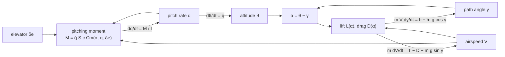

*Figure: the two loops that the lag model did not have. The angle of attack is now the difference of two states, the moment closes a loop through $q$ and $\theta$, and lift closes one through $\gamma$.*

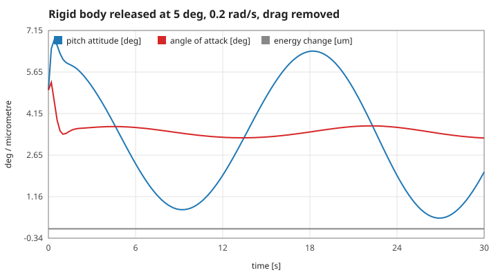

*Figure: the rigid body released from 5° attitude with a 0.2 rad/s nose-up rate and the drag removed. The short period settles the angle of attack within about a second; the attitude then swings with the slow phugoid. The energy change (grey, in micrometres of height) stays at zero.*

**Assumptions and where they break.** Body pitch only (no roll or yaw); flat Earth; still air; constant density; thrust along the flight path; the angle of attack stays below the stall in the linear analysis below (the simulation keeps the nonlinear lift curve). Like S05 the equations divide by $V$ and fail at zero airspeed.

**Derivation.** Newton's second law in path axes gives the $\dot V$ and $\dot\gamma$ equations of S05; Euler's equation for rotation about the lateral axis through the centre of gravity gives $I_{yy}\dot q = M$. The attitude is the integral of the rate. At the trim point all derivatives vanish: $\dot V = \dot\gamma = 0$ by S06, $\dot q = 0$ because the elevator makes $C_m = 0$, $\dot\theta = q = 0$.

**Code.** `pitch_step` (fourth-order Runge–Kutta, as S10), `pitch_alpha` and `pitch_trim` in `src/pitch.c`.

**Tests.** `test_trim_is_an_equilibrium`, `test_energy_is_conserved_without_drag` in `tests/test_pitch.c`; measured values `pitch-trim-drift` (0 rad over 30 s), `pitch-trim-speed` (28.6695 m/s, unchanged), `pitch-energy` ($2\times10^{-13}$ relative change in 30 s).

## S22 — Linearisation: two oscillations

**Statement.** About the trimmed glide, small disturbances of $(V, \gamma, \theta, q)$ obey $\dot{\mathbf x} = A\,\mathbf x$, with $A$ the Jacobian of the right-hand side ($x$ and $h$ do not feed back: density is constant). For a statically stable glider the four eigenvalues of $A$ form two complex pairs of very different size: the **short period** (fast, well damped, mostly $\alpha$ and $q$ at nearly constant speed) and the **phugoid** (slow, lightly damped, mostly speed and height at nearly constant $\alpha$). At the default static margin

$$\lambda_\text{sp} = -2.720 \pm 3.193\,i\ \mathrm{s^{-1}},\qquad \lambda_\text{ph} = -0.0065 \pm 0.3716\,i\ \mathrm{s^{-1}},$$

eleven times apart in natural frequency.

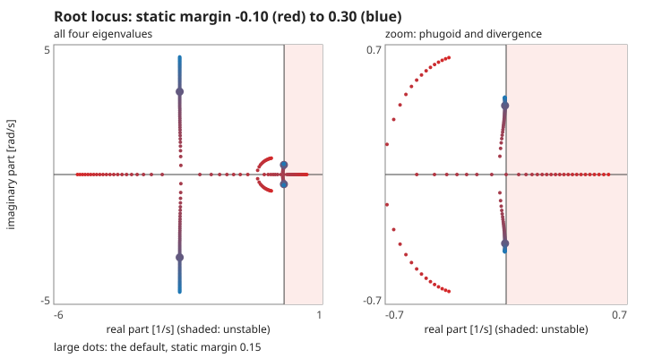

*Figure: the four eigenvalues as the centre of gravity moves from 0.10 behind the neutral point (red) to 0.30 ahead of it (blue); large dots are the default. Left, the whole plane: the short-period pair rises along a vertical line as the margin grows. Right, a zoom near the origin: the phugoid pair, and for negative margins a real eigenvalue in the shaded unstable half-plane.*

**Assumptions and where they break.** Small disturbances (linear); the trim point below the stall. The Jacobian is taken by central differences of the nonlinear right-hand side with a step of $1\times10^{-6}$ (relative for $V$).

**Derivation.** Expand the right-hand side of S21 to first order about the trim point. The characteristic polynomial $\det(\lambda I - A)$ is formed by the Faddeev–LeVerrier recursion and its four roots are found by the Durand–Kerner iteration; roots are sorted by modulus, so the first pair is the short period.

**Code.** `pitch_jacobian`, `pitch_eigen`, `pitch_modes` in `src/pitch.c`.

**Tests.** `test_eigen_solver_on_a_known_matrix` (roots $-1 \pm 2i$, $3$, $-0.5$ recovered to $1\times10^{-10}$) and `test_two_modes_and_the_short_period_approximation` in `tests/test_pitch.c`; measured values `eigen-check`, `modes-oscillatory`, `sp-eig-re`, `sp-eig-im`, `ph-eig-re`, `ph-eig-im`, `mode-separation` (11.28).

Reference: Etkin and Reid (1996), §6.2–6.3.

## S23 — The short-period approximation

**Statement.** Holding the airspeed constant and dropping gravity's slow terms leaves two states, $\alpha$ and $q$:

$$\dot\alpha = q - Z\,\alpha,\qquad \dot q = M_\alpha\,\alpha + M_q\,q,$$

$$Z = \frac{\bar q S C_{L\alpha}}{mV},\quad M_\alpha = \frac{\bar q S c\,C_{m\alpha}}{I_{yy}},\quad M_q = \frac{\bar q S c}{I_{yy}}\,C_{mq}\frac{c}{2V},$$

so that

$$\omega_\text{sp}^2 = -M_\alpha - Z M_q,\qquad 2\zeta_\text{sp}\,\omega_\text{sp} = Z - M_q .$$

At the default this gives 4.177 rad/s and $\zeta$ 0.648; the full eigenvalue gives 4.194 rad/s and 0.6485 (0.4 % and 0.07 % apart). A further-forward centre of gravity raises the frequency and lowers the damping.

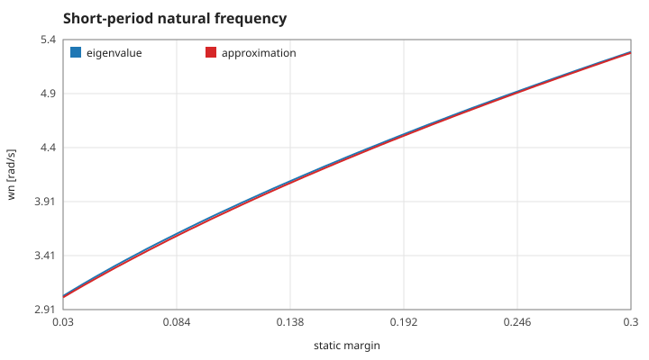

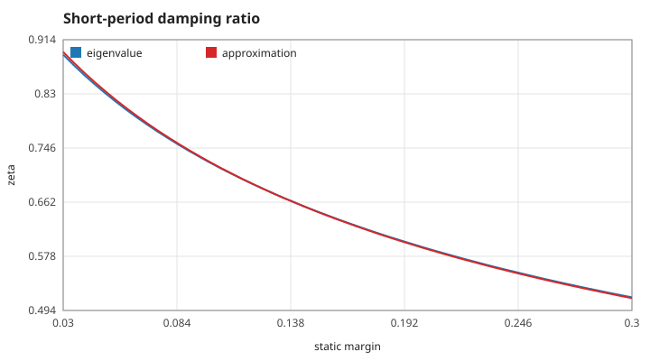

*Figures: natural frequency and damping ratio of the short period against the static margin, from the eigenvalues of S22 (blue) and from the two formulas above (red). They agree within 0.6 % over the whole range.*

**Assumptions and where they break.** The modes are well separated (S22) so that $V$ hardly moves during a short-period cycle; drag's dependence on $\alpha$ and the $g\cos\gamma$ term are dropped. The approximation degrades as the margin approaches zero, where the fast and slow roots meet (S27).

**Derivation.** With $V$ fixed, $\dot\gamma = (L - mg\cos\gamma)/(mV)$ linearises to $\dot\gamma = Z\alpha$, and $\dot\alpha = \dot\theta - \dot\gamma = q - Z\alpha$. The moment equation of S21 linearises to $\dot q = M_\alpha\alpha + M_q q$. The characteristic polynomial of the 2×2 matrix is $\lambda^2 + (Z - M_q)\lambda + (-M_\alpha - Z M_q)$; compare with $\lambda^2 + 2\zeta\omega\lambda + \omega^2$.

**Code.** `pitch_short_period_approx` in `src/pitch.c`.

**Tests.** `test_two_modes_and_the_short_period_approximation` in `tests/test_pitch.c` (five margins, frequency and damping within 5 %); measured values `sp-wn` (0.40 %), `sp-zeta` (0.07 %), `sp-wn-0.05` (0.57 %).

Reference: Etkin and Reid (1996), §6.4; M. V. Cook, *Flight Dynamics Principles*, 3rd ed., Butterworth-Heinemann (2013), §6.3.

## S24 — The phugoid of the rigid body

**Statement.** The phugoid of the rigid-body glider is Lanchester's (S08) slowed by pitch damping:

$$T_\text{ph} = \pi\sqrt2\,\frac{V}{g}\,\sqrt{1 + Z\kappa},\qquad \kappa = \frac{C_{mq}\,c}{2V\,C_{m\alpha}} .$$

At the default the eigenvalue gives 16.91 s and the formula 16.84 s; Lanchester alone gives 12.99 s. With $C_{mq} = 0$ the period returns to Lanchester's (13.09 s against 12.99 s). The lag model of S08–S09 holds $\alpha$ at the command and has no such term: its phugoid test against Lanchester is unchanged.

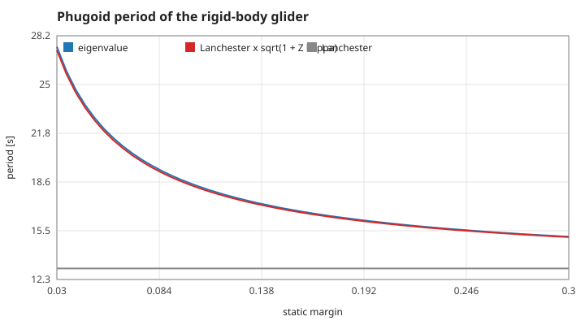

*Figure: phugoid period against the static margin. Eigenvalue (blue), Lanchester with the pitch-damping factor (red), Lanchester (grey). A stiffer pitch (larger margin) holds $\alpha$ more firmly and the period approaches Lanchester's.*

**Assumptions and where they break.** The short period has settled, so the moment is in balance on the phugoid's time scale ($C_{m\alpha}\Delta\alpha + C_{mq}qc/2V = 0$) and $q \approx \dot\gamma$; drag is neglected in the period (it sets the slow damping). Near the neutral point $\kappa$ grows without bound and the formula fails.

**Derivation.** The quasi-static moment balance gives $\Delta\alpha = -\kappa q \approx -\kappa\dot\gamma$. In the lift equation $mV\dot\gamma = L - mg\cos\gamma$ this adds $\bar q S C_{L\alpha}\Delta\alpha = -mVZ\kappa\,\dot\gamma$, so $(1 + Z\kappa)\,mV\dot\gamma = L(V) - mg\cos\gamma$: the restoring force of Lanchester's derivation acts on an effective inertia $1 + Z\kappa$ times larger, which divides the frequency by $\sqrt{1 + Z\kappa}$.

**Code.** `pitch_phugoid_theory` in `src/pitch.c` (the eigenvalue from `pitch_modes`).

**Tests.** `test_two_modes_and_the_short_period_approximation` (five margins, within 5 %) and `test_phugoid_without_pitch_damping_is_lanchester` in `tests/test_pitch.c`; measured values `ph-period` (0.42 %) and `ph-period-no-damping` (0.77 %).

## S25 — The simulated response follows the eigenvalue

**Statement.** Started on the short-period eigenvector, the nonlinear simulation's pitch rate is $q(t) = q_0\,e^{\sigma t}\cos(\omega_d t)$ with $\sigma + i\omega_d = \lambda_\text{sp}$: successive zero crossings are $\pi/\omega_d$ apart and successive (opposite) peaks shrink by $e^{-\sigma\pi/\omega_d}$. Measured from the simulation: $\omega_d$ = 3.19196 rad/s against 3.19259 (0.02 %), $\zeta$ = 0.64876 against 0.64850 (0.04 %).

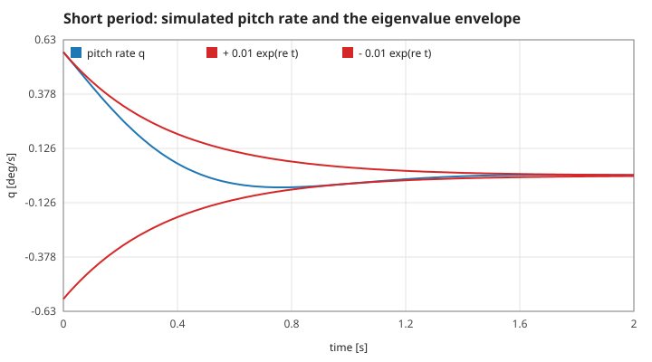

*Figure: the simulated pitch rate (blue) inside the envelope $\pm q_0 e^{\sigma t}$ given by the eigenvalue (red). With damping 0.65 one overshoot is visible before the motion has died out — the short period of a glider is a quick, firm settling, not a ringing.*

**Assumptions and where they break.** Small amplitude (0.01 rad/s) so the motion is linear; the start on the eigenvector excites no phugoid. A plain kick would add a phugoid component that shifts the second zero crossing; the eigenvector start isolates the mode being measured.

**Derivation.** For a linear system started at $\mathrm{Re}(\mathbf v)$, with $A\mathbf v = \lambda\mathbf v$, the solution is $\mathrm{Re}(\mathbf v\,e^{\lambda t})$; the $q$ component is a damped cosine. The eigenvector (scaled to $v_q = 1$) solves the first three rows of $(A - \lambda I)\mathbf v = 0$.

**Code.** `pitch_step` in `src/pitch.c`; the measurement helpers `pm_short_period_vector` and `pm_short_period_response` in `tests/pitch_measure.h`.

**Tests.** `test_response_matches_the_eigenvalue` in `tests/test_pitch.c` (three margins; frequency within 2 %, damping within 5 %); measured values `sp-measured-wd` and `sp-measured-zeta`.

## S26 — An elevator step and the new trim

**Statement.** After a step of the elevator from $\delta_0$ to $\delta_1$ the angle of attack settles at $\alpha_\text{trim}(\delta_1)$ of S20: the change is $C_{m\delta_e}\Delta\delta_e / C_{m\alpha}$, independent of speed. One degree of trailing edge up at the default margin raises it by 1.4545°. The short period carries $\alpha$ there within about a second; the airspeed then drifts to the new steady glide through the phugoid.

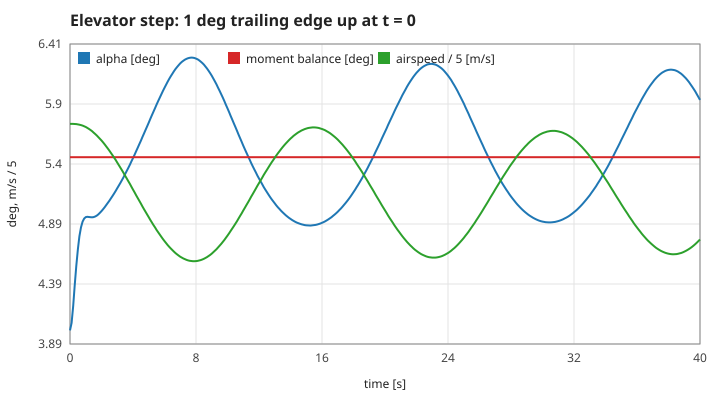

*Figure: angle of attack (blue) and airspeed ÷ 5 (green) after a 1° nose-up elevator step at t = 0. The angle of attack reaches the moment-balance value (red) almost at once; the slow swing of the airspeed is the phugoid, and with it a small swing of $\alpha$ through the pitch-damping term of S24.*

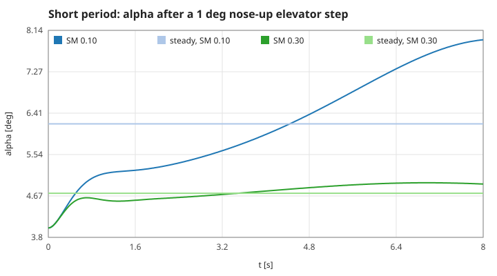

*Figure: the terminal program's chart (`./lift-pilot --pitch docs/pitch.svg`, part of `make plots`): the same step for two centre-of-gravity positions. Further forward (SM 0.30) the step changes $\alpha$ less and the settling is quicker.*

**Assumptions.** Linear lift curve (the new trim is below the stall); constant density.

**Derivation.** In a steady state $q = 0$ and $\dot q = 0$, so $C_m = 0$: S20 gives $\alpha$. Speed does not enter because $C_m$ does not depend on $V$ (only the size of the moment, $\bar q$, does).

**Code.** `pitch_trim_alpha` and `pitch_step` in `src/pitch.c`; `pitch_chart` in `src/main.c`.

**Tests.** `test_elevator_step_settles_at_the_moment_balance` in `tests/test_pitch.c` (within $1\times10^{-6}$ rad after 3000 s); measured values `step-alpha` and `step-delta`.

## S27 — Behind the neutral point the glider diverges

**Statement.** The product of the four eigenvalues, $\det A$, is proportional to the static margin: $+0.8099\ \mathrm{s^{-4}}$ at SM 0.05 and $-0.8099\ \mathrm{s^{-4}}$ at SM −0.05. A negative determinant forces a positive real eigenvalue, so behind the neutral point any disturbance grows as $e^{\lambda t}$ — at SM −0.05, $\lambda = 0.3347\ \mathrm{s^{-1}}$ (the disturbance doubles every 2.1 s). At SM 0 one eigenvalue is zero (neutral stability).

The two-state short-period approximation of S23 does not see this: at SM −0.05 its stiffness $-M_\alpha - ZM_q$ is still positive (1.90 rad/s). The divergence comes through the speed: with the moment no longer restoring, the glider trades speed and path angle away from the trim and never comes back.

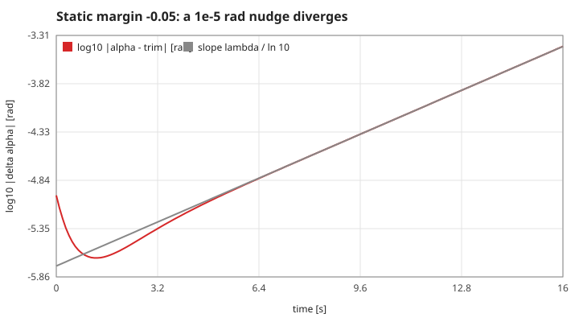

*Figure: a $1\times10^{-5}$ rad nudge in attitude at SM −0.05. On a logarithmic scale the disturbance becomes a straight line with the slope of the positive eigenvalue (grey). See also the red real root in the right panel of the root locus (S22).*

**Assumptions and where they break.** Linear: the straight line ends when the disturbance reaches the stall or the airspeed limits (the pitch laboratory stops at |α| > 25° or V outside 8–80 m/s).

**Derivation.** $\det A = \prod_i \lambda_i$. Complex eigenvalues come in conjugate pairs with a positive product, so a negative determinant needs an odd number of negative real roots among the reals — with four roots, at least one real root is positive. The determinant is the constant term of the characteristic polynomial; it changes sign as the margin passes zero (measured: equal and opposite at ±0.05), which is the classical statement that static stability is required for dynamic stability.

**Code.** `pitch_jacobian`, `pitch_eigen` in `src/pitch.c`; `pm_growth_rate` in `tests/pitch_measure.h`.

**Tests.** `test_negative_static_margin_diverges` in `tests/test_pitch.c` (growth rate between 10 s and 16 s against the eigenvalue within 3 %; every eigenvalue at SM 0.15 has a negative real part); measured values `diverge-lambda`, `diverge-rate` (0.026 %), `det-plus`, `det-minus`, `approx-wn-minus`, `neutral-root`.

Reference: Etkin and Reid (1996), §6.6.

## S28 — The step size and the short period

**Statement.** One RK4 step multiplies a mode with eigenvalue $\lambda$ by $R(\lambda\,dt) = 1 + z + z^2/2 + z^3/6 + z^4/24$, $z = \lambda\,dt$. The integration is stable only while $|R| \le 1$ for every mode; the fast short period sets the limit. At the default margin $|R| = 1$ at $dt$ = 0.6334 s, and bisection on the simulation finds the same limit (0.63339 s). The game step 0.02 s is 31.7 times smaller.

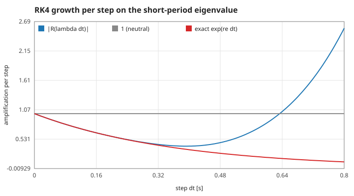

*Figure: the amplification per step along the short-period eigenvalue (blue) against the exact decay $e^{\sigma\,dt}$ (red). At small steps they coincide; near 0.63 s RK4 crosses 1 (grey) and the computed motion grows although the true motion decays.*

**Assumptions.** The disturbance is small (linear) and the phugoid's $|R|$ stays below 1 at these steps. The fourth-order accuracy of S11 is the same scheme; this is its stability, not its accuracy.

**Derivation.** For $\dot x = \lambda x$ the four RK4 stages give $x_{n+1} = R(\lambda\,dt)\,x_n$ with $R$ the Taylor polynomial of $e^z$ to fourth order. Bisection on $dt$ along the fixed direction of $\lambda_\text{sp}$ finds where $|R|$ reaches 1.

**Code.** `pitch_step` in `src/pitch.c`; `pm_rk4_limit_theory` and `pm_rk4_limit_measured` in `tests/pitch_measure.h`.

**Tests.** `test_rk4_stability_limit` in `tests/test_pitch.c` (measured limit within 1 % of the theory, and more than ten game steps); measured values `rk4-pitch-limit` and `rk4-pitch-margin`.

Reference: Hairer, Nørsett and Wanner (1993), §IV.2.

## S29 — From the pitch model to the pitch laboratory

**Statement.** The browser's pitch laboratory shows numbers computed by `src/pitch.c` compiled to WebAssembly. One rigid-body glider is trimmed at 4° with the chosen static margin (−0.10 to 0.30); its four eigenvalues, the short-period approximation and the phugoid formula are computed once per reset. Each frame advances whole 0.02 s steps with the elevator at the trim value plus the offset the slider sets (±5°), or after a pitch-rate kick; the simulation stops if the glider departs (|α| > 25° or V outside 8–80 m/s).

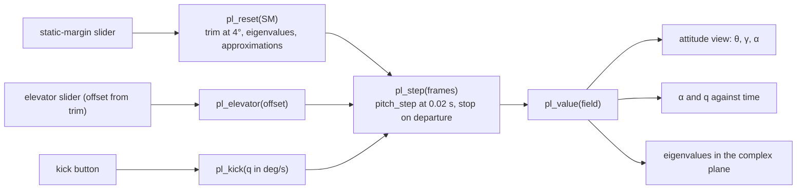

*Figure: the data path of the pitch laboratory. JavaScript only draws and passes the slider values; integration, trim and eigenvalues are in C.*

**Assumptions.** The laboratory starts 1000 m up and has no ground; it is an observation of the pitch motion, not a landing exercise.

**Derivation.** Not a physical law: a statement of what is displayed.

**Code.** `pl_reset`, `pl_elevator`, `pl_kick`, `pl_step`, `pl_value` in `src/pitch_lab.c`.

**Tests.** `scripts/smoke.cjs` compares `_pl_value` read in the page against the eigenvalues computed by the same build and drives the sliders and buttons on desktop and phone sizes.
