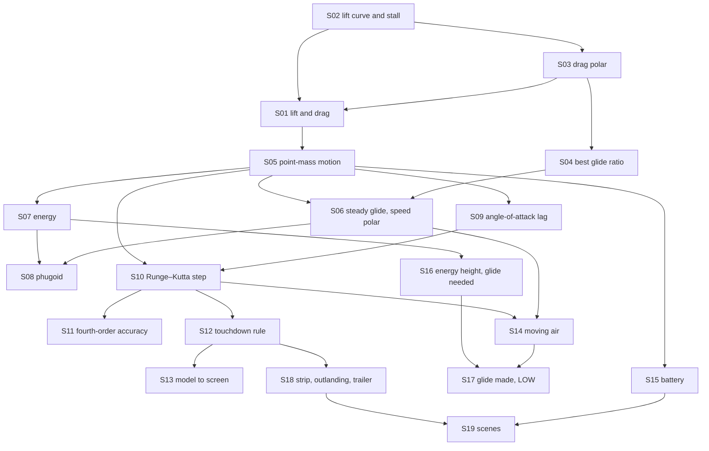

# Theory handbook

Why the program is correct, from the repository alone: every law, numerical rule and game rule the code relies on, each stated in Markdown **with a figure**, the place in the code that implements it, and the test or measurement that checks it.

- SI units: metres, seconds, kilograms, newtons, radians (degrees where a control or an axis says so).
- Plotted figures and the numbers quoted in the text are produced by the flight model itself: `make theory-figs` rewrites [figures/](figures/) and [figures/values.md](figures/values.md). Diagrams are Mermaid, written in the pages.
- `make theory-check` fails when a statement has no figure, a link is broken, a referenced function or test no longer exists, or a public function is missing from the tables below.

## Pages

1. [Aerodynamic forces](01-aerodynamics.md) — lift and drag, the lift curve and the stall, the drag polar, best glide
2. [Equations of motion](02-motion.md) — point-mass motion, the steady glide and the speed polar, energy, the phugoid, the angle-of-attack lag
3. [The numerical scheme, the ground and the screen](03-numerics-and-ground.md) — the Runge–Kutta step, its accuracy, the touchdown rule, the path to the cockpit
4. [The Last Ferry: the rules of the game layer](04-last-ferry.md) — moving air, the battery, the two glide gauges, outlandings, scenes

## How the pieces depend on each other

## Coverage: statement → page → figure → code → test

| ID | Statement | Page | Figure | Code | Test |
|---|---|---|---|---|---|
| S01 | Lift and drag $qSC_L$, $qSC_D$ | [1](01-aerodynamics.md) | `figures/forces.svg` | `src/flight.c#lift_force`, `src/flight.c#drag_force`, `src/flight.c#glider_default` | `tests/test_flight.c#test_steady_glide_stays_steady` |
| S02 | Lift curve and stall | [1](01-aerodynamics.md) | `figures/coefficients.svg` | `src/flight.c#lift_coeff` | `tests/test_flight.c#test_lift_peaks_at_the_stall_angle` |
| S03 | Drag polar $C_{D0} + kC_L^2$ | [1](01-aerodynamics.md) | `figures/polar.svg` | `src/flight.c#drag_coeff` | `tests/test_flight.c#test_best_glide_matches_the_polar` |
| S04 | Best glide ratio $1/(2\sqrt{C_{D0}k})$ | [1](01-aerodynamics.md) | `figures/glide-ratio.svg` | `src/flight.c#best_glide_ratio` | `tests/test_flight.c#test_best_glide_matches_the_polar` |
| S05 | Point-mass equations of motion | [2](02-motion.md) | mermaid | `src/flight.c#derivative` | `tests/test_flight.c#test_energy_is_conserved_without_drag` |
| S06 | Steady glide and the speed polar | [2](02-motion.md) | `figures/speed-polar.svg` | `src/flight.c#trim_glide` | `tests/test_flight.c#test_steady_glide_stays_steady` |
| S07 | Energy: $\dot e = (T - D)V/m$ | [2](02-motion.md) | `figures/energy.svg` | `src/flight.c#specific_energy` | `tests/test_flight.c#test_energy_is_conserved_without_drag` |
| S08 | Phugoid period $\pi\sqrt2\,V/g$ | [2](02-motion.md) | `figures/phugoid.svg` | `src/flight.c#flight_step` | `tests/test_flight.c#test_phugoid_period_follows_lanchester` |
| S09 | Angle-of-attack lag | [2](02-motion.md) | `figures/lag.svg` | `src/flight.c#derivative` | `tests/theory_figs.c#lag-at-0.24s` |
| S10 | Runge–Kutta step | [3](03-numerics-and-ground.md) | mermaid | `src/flight.c#flight_step` | `tests/test_observer.c#lp_value(LP_X)` |
| S11 | Fourth-order accuracy | [3](03-numerics-and-ground.md) | `figures/rk4.svg` | `src/flight.c#flight_step` | `tests/theory_figs.c#rk4-order` |
| S12 | Touchdown: landing or crash | [3](03-numerics-and-ground.md) | `figures/touchdown.svg` | `src/flight.c#check_touchdown` | `tests/test_flight.c#test_touchdown_rating` |
| S13 | From the model to the screen | [3](03-numerics-and-ground.md) | mermaid | `src/observer.c#lp_reset`, `src/observer.c#lp_controls`, `src/observer.c#lp_step`, `src/observer.c#lp_value`, `src/render.c#render_frame` | `tests/test_observer.c#lp_reset(1)` |
| S14 | Moving air | [4](04-last-ferry.md) | `figures/air.svg` | `src/ferry.c#ferry_tick` | `tests/test_ferry.c#[flight] still air` |
| S15 | The battery | [4](04-last-ferry.md) | `figures/battery.svg` | `src/ferry.c#ferry_tick` | `tests/test_ferry.c#[mech] hangar` |
| S16 | Energy height and the glide needed | [4](04-last-ferry.md) | `figures/gauges.svg` | `src/ferry.c#ferry_need` | `tests/theory_figs.c#need-start` |
| S17 | Glide made and the LOW gauge | [4](04-last-ferry.md) | mermaid | `src/ferry.c#ferry_low_on`, `src/ferry.c#glide_step` | `tests/test_ferry.c#[mech] all story numbers off` |
| S18 | Strip, outlanding, trailer | [4](04-last-ferry.md) | mermaid | `src/ferry.c#outland`, `src/ferry.c#clear_hop` | `tests/test_ferry.c#[mech] outlanding` |
| S19 | Scenes and the numbers they change | [4](04-last-ferry.md) | mermaid | `src/ferry.c#ferry_init`, `src/ferry.c#ferry_answer`, `src/ferry.c#ferry_options`, `src/ferry.c#ferry_heavy`, `src/ferry.c#ferry_ending`, `src/ferry.c#ferry_value` | `tests/test_ferry.c#[order]` |

Tests named `tests/theory_figs.c#…` are measurements recorded in [figures/values.md](figures/values.md) by `make theory-figs`, not assertions of `make test`. S09, S11 and S16 are covered only that way; turning them into assertions is a follow-up. Writing S17 down exposed a defect in the start value of the glide-made readout (issue #15), since fixed; the story numbers were retuned with it (see `docs/validation.md`).

## Public functions that state no law

| Function | What it is |
|---|---|
| `src/svg.c#svg_plot` | writes the line charts of this handbook and of `make plots` |
| `src/gif.c#gif_open`, `src/gif.c#gif_frame`, `src/gif.c#gif_close`, `src/gif.c#gif_text_size`, `src/gif.c#gif_draw_text` | GIF89a/LZW encoder for the demo animation |

## Reading the source against this table

Functions reviewed for this handbook: every declaration in `src/flight.h`, `src/observer.h`, `src/ferry.h`, `src/render.h`, `src/svg.h` and `src/gif.h`, plus the static helpers `derivative`, `advance` and `dynamic_pressure` in `src/flight.c` and `energy_height`, `glide_step`, `launch`, `start_hop`, `outland`, `clear_hop` in `src/ferry.c`. `src/main.c` (terminal program and plots) and `src/ferry_web.c` (WebAssembly wrapper) call these functions and state no law of their own.
